# BAR Droid: the full guide

This guide shows you how to play Beyond All Reason (BAR) on an Android phone with BAR Droid. It starts with the install and your first game, then explains every control, the layout editor and every setting. Beginners can read it from the top. Experienced players can jump to the "For pros" parts of each chapter.

BAR Droid is a fan project. It is not made by the Beyond All Reason team. BAR itself is a free game: [beyondallreason.info](https://www.beyondallreason.info/).

---

## Quick start

1. Check your phone: a Snapdragon 8 Gen 2 or newer (Adreno 7xx or 8xx GPU), 12 GB of RAM (8 GB phones work in a low-memory mode) and about 6 GB of free storage.
2. Download `bar-droid-phone-<version>.apk` from the project's Releases page on GitHub and open it on the phone. Allow installing from your browser or file manager when Android asks.
3. Open **Beyond All Reason**. On the launcher screen, tap **Install / Update**. It downloads about 4 GB (a small Linux system and the GPU driver, then BAR from its own servers), around 12 minutes on home Wi-Fi.
4. Tap **Play vs AI** for a game against the computer, or **Lobby** to log in and play online.
5. In the game: drag to pan, pinch to zoom, tap to select, long press to send units. Held upright, use the touch dock at the bottom of the screen.
6. Hold three fingers on the screen to open the layout editor, where you move and size panels.

Next, read [Your first game in 10 minutes](#your-first-game-in-10-minutes).

---

## Contents

- [Quick start](#quick-start)
- [What BAR Droid is](#what-bar-droid-is)
  - [The phone engine](#the-phone-engine)
- [What phone you need](#what-phone-you-need)
- [Install and first run](#install-and-first-run)
- [The launcher screen](#the-launcher-screen)
- [The lobby](#the-lobby)
- [Your first game in 10 minutes](#your-first-game-in-10-minutes)
- [The touch dock](#the-touch-dock)
  - [How the dock works](#how-the-dock-works)
  - [Upright: a tall phone](#upright-a-tall-phone)
  - [Unfolded: the split dock](#unfolded-the-split-dock)
  - [Sideways: the one-thumb dock](#sideways-the-one-thumb-dock)
  - [Before the game starts](#before-the-game-starts)
  - [Turning the phone](#turning-the-phone)
- [Touch gestures on the game](#touch-gestures-on-the-game)
- [The camera](#the-camera)
  - [The camera knob and the edge rails](#the-camera-knob-and-the-edge-rails)
- [Selecting units](#selecting-units)
- [Giving orders](#giving-orders)
  - [Presets: formations and strafing](#presets-formations-and-strafing)
- [Building](#building)
  - [Walls around sentries](#walls-around-sentries)
  - [Metal extractors: auto mex and Area Mex](#metal-extractors-auto-mex-and-area-mex)
  - [Factories](#factories)
- [Economy: metal, energy, wind and tide](#economy-metal-energy-wind-and-tide)
- [The unit info panel](#the-unit-info-panel)
- [Combat helpers](#combat-helpers)
  - [The D-gun mode](#the-d-gun-mode)
  - [Auto retreat](#auto-retreat)
  - [Pings and under-attack alerts](#pings-and-under-attack-alerts)
- [Chat](#chat)
- [Spectating and replays](#spectating-and-replays)
- [BAR's windows on a phone](#bars-windows-on-a-phone)
- [Gamepad](#gamepad)
- [Mouse and keyboard](#mouse-and-keyboard)
- [The layout editor](#the-layout-editor)
  - [What the editor changes](#what-the-editor-changes)
  - [Open and close the editor](#open-and-close-the-editor)
  - [The control bar](#the-control-bar)
  - [Every panel and what it allows](#every-panel-and-what-it-allows)
  - [Layouts per screen shape](#layouts-per-screen-shape)
  - [Editor recipes](#editor-recipes)
- [Every launcher setting explained](#every-launcher-setting-explained)
- [Performance and heat](#performance-and-heat)
- [Troubleshooting and logs](#troubleshooting-and-logs)
- [FAQ](#faq)
- [Glossary](#glossary)
- [Credits](#credits)

---

## What BAR Droid is

BAR Droid plays Beyond All Reason on an Android phone. You get BAR's own lobby, online games with everyone else, skirmishes against the AI, scenarios, spectating and replays. On a Snapdragon 8 Elite phone it runs at about 30 frames a second.

How it works, in short:

- The app runs BAR's real engine (Recoil), built for ARM, on the phone's own CPU and GPU. It runs inside a small Linux environment (Debian) that the app downloads and sets up on the first install. There is no emulation and no translation.
- Apart from the phone engine (below) and upright copies of BAR's loading pictures, nothing of BAR's game is inside the app. Like BAR's PC launcher, the app downloads the game, its maps and BAR's official engine from BAR's own servers.
- The engine is at the same version BAR's servers run, so your online games stay in step with players on PCs.

What the app adds to BAR:

- **The touch dock**: a panel of large buttons at the bottom of the screen with the build grid, the orders, your resources and your unit groups. It has a layout for each screen shape: upright, unfolded and sideways.
- **Touch gestures** on the game itself: pan, zoom, turn, tilt, select, give orders.
- **The one-finger camera**: a knob and two rails over the map that zoom and turn the camera.
- **Gamepad controls** in every game, built on the layout of BAR Controller Support v0.8.5.
- **Mouse and keyboard** support that plays like BAR on a PC.
- **The layout editor**: move and size the interface's panels.
- **The unit info panel**: BAR's numbers for the units you picked.
- **Helpers** for touch play: presets (formations), auto retreat, walls around sentries, auto mex, the D-gun mode, speak to chat and pings.
- **Phone layouts** of BAR's Settings, Statistics and Mission Info windows.

BAR Droid is complete and fully playable: full games from the lobby to the end, online or against the AI. Late games with big battles run slower, but the game keeps pace with everyone else. Its author does not plan to keep developing it. The hope is that BAR's developers and community use it as a step towards an official BAR for Android.

### The phone engine

By default the app runs its own build of BAR's engine, made for phones from the same source as BAR's. It is called the phone engine. It gives you:

- The app's touch and gamepad controls in every game. They load as part of the game, so a host's "no user widgets" option no longer turns them off.
- BAR's Settings window laid out for an upright or sideways phone.
- Phone versions of BAR's costliest interface code, and memory settings that let 8 GB phones load big games.
- A faster version of the game simulation (about 4-5 % more game speed) in skirmishes and replays. Online, the engine keeps BAR's own simulation code.

The launcher setting **Phone engine** turns it off. The app then runs BAR's official engine, and the controls load as user widgets, which a host can turn off.

> **Note:** If BAR's servers move to an engine version the app has no phone build of, every game runs BAR's official engine until a new version of the app comes out.

---

## What phone you need

| What | You need |
|---|---|
| Chip | A Qualcomm Snapdragon with an Adreno 7xx or 8xx GPU: Snapdragon 8 Gen 2, 8 Gen 3, 8s Gen 3 or 8 Elite |
| Memory | 12 GB of RAM. Phones with 8 GB play in a low-memory mode |
| Storage | About 6 GB free. BAR takes about 2.7 GB after the install, and downloaded maps take up to 3 GB by default |
| Not supported | Phones with Mali, Xclipse or Tensor GPUs. There is no driver for them. The app's device check says so |

The app was tested on a Galaxy Z Fold7 (Android 17) and a Galaxy S23 Ultra (8 GB).

A match uses about 5 to 6 GB of memory. Close other big apps before you play.

**8 GB phones.** The app switches to a low-memory mode by itself. It uses plainer unit shading, leaves out shore foam and ground scorch marks, and sets Play vs AI to a smaller map (Starwatcher) until you pick another one. On a Galaxy S23 Ultra (8 GB), BAR's own benchmark battle runs through every time, at about 12 fps, and so do skirmishes on that map. On a big map about 1 game in 3 is closed by Android for lack of memory. Replays of online 8v8 games play at about 15-20 fps there. Joining online games on an 8 GB phone has not been tested.

> **Tip:** The launcher's device lines tell you what the app found: your phone, the GPU and whether it is supported, free storage, RAM and whether the low-memory mode is on.

---

## Install and first run

1. On the phone, download `bar-droid-phone-<version>.apk` from the project's Releases page on GitHub.
2. Open the file. When Android asks, allow installing apps from your browser or file manager.
3. Open the new app. It is called **Beyond All Reason**.
4. The first time, the launcher screen opens. Tap **Install / Update**.
5. Wait. The app downloads about 4 GB: a small Linux system and the GPU driver, then the engine, the game and the lobby from BAR's servers. This takes around 12 minutes on home Wi-Fi. When it is done, BAR takes about 2.7 GB on the phone.
6. Tap **Play vs AI** for a skirmish against the AI, or **Lobby** to open BAR's lobby.

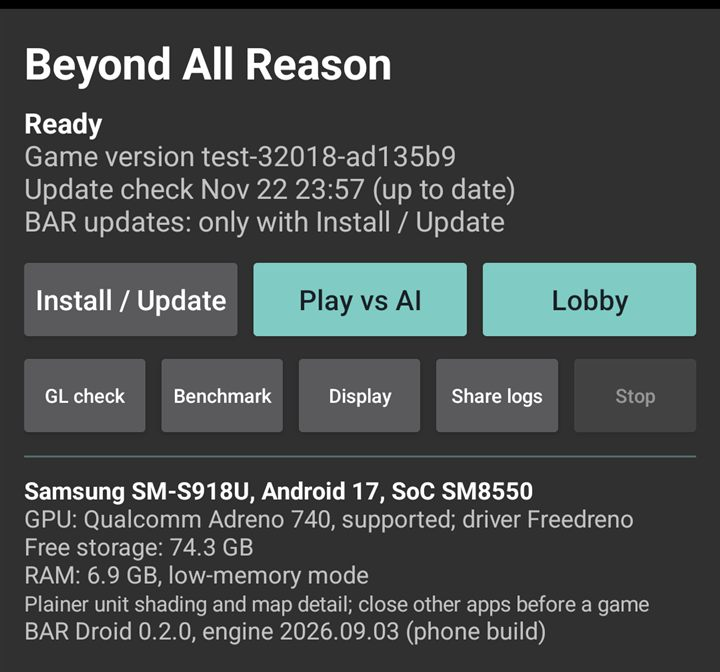

After the first install, the app icon opens the lobby straight away (the setting "Open the lobby when the app starts"). To reach the launcher screen again, long-press the app icon and tap **Launcher**.

**Updates.** The app updates BAR at every start, as BAR's PC launcher does: the engine, the game and the lobby. If an update fails on its first start, the app goes back to the last version that worked. The launcher shows the game version the last start played, for example "Game version test-32018-ad135b9". Compare it with your friends before an online game.

**While a game runs** the app shows one notification with a Stop button. Tap the notification to go back to the game. If you leave the game, it shows in a floating window.

> **Tip:** With no internet connection, the app starts what is already installed. Play vs AI and the lobby's Skirmish work offline, but only on maps already on the phone.

> **Note:** On a weak connection, a start can wait up to about 45 seconds while BAR's update check waits for an answer. Turn off "Update BAR at every start" to skip it. Then only the Install / Update button updates BAR.

---

## The launcher screen

The launcher screen is where you start games and change the app's settings. It has a status line, the buttons, the device lines, the settings and a log.

**The status line** says what the app is doing, in the same words as the notification: "Ready", "Starting", "Installing: ...", "Skirmish running". It also shows the game version, when BAR last checked for updates, and whether BAR updates at every start.

**The buttons:**

| Button | What it does |
|---|---|
| Install / Update | Downloads BAR's engine, game and lobby from BAR's servers, or updates them |
| Play vs AI | Starts a skirmish against the AI on the map set under "Map for Play vs AI" |
| Lobby | Opens BAR's lobby: log in, play online, set up skirmishes, scenarios, replays |
| GL check | Checks that the phone's graphics driver works for BAR and shows the result in the launcher |
| Benchmark | Plays BAR's "Benchmark BAR" scenario, a big battle, and shows the result in the launcher |
| Display | Opens "Display & touch preferences", the display server's own settings |
| Share logs | Makes a zip of the app's and the game's logs and settings, for a bug report |
| Stop | Ends the running game, lobby or update |

**The device lines** show your phone model and Android version, the GPU (and "supported"), the driver, free storage, RAM, the low-memory mode, and the app and engine versions ("phone build" for the phone engine).

**The settings** come in three groups: Game, Graphics and Advanced. Each shows its name first and what it does under it. [Every launcher setting explained](#every-launcher-setting-explained) goes through them one by one. The start buttons always use what the screen shows, so you do not need to tap **Save settings** before you start a game.

**The log** at the bottom shows what the app did, and how the last run ended.

> **Tip:** Use **Stop** (or BAR's own Quit) to end a game. The app first asks the game to quit, so the replay is written. A game killed from Android's settings can leave an empty replay.

**Display & touch preferences.** The **Display** button opens the display server's settings: Output (resolution, display scale, filtering, screen timeout), Pointer, Keyboard and Other. Most players never need them. One worth knowing: Output's **Display scale (%)**. Over 100 the game gets fewer pixels, each one larger (150 gives two thirds as many lines). Under 100 it gets more, up to the app's limit of 2100 x 900 pixels, which most phones reach at 100.

---

## The lobby

The lobby is BAR's own lobby, with changes for fingers and small screens. From here you log in, join online games, set up skirmishes, play scenarios, load saved games and watch replays.

### Logging in or playing offline

The first time you open the lobby, BAR shows its "Register your account" window. It has three tabs: **Login**, **Register** and **Recover/Change**.

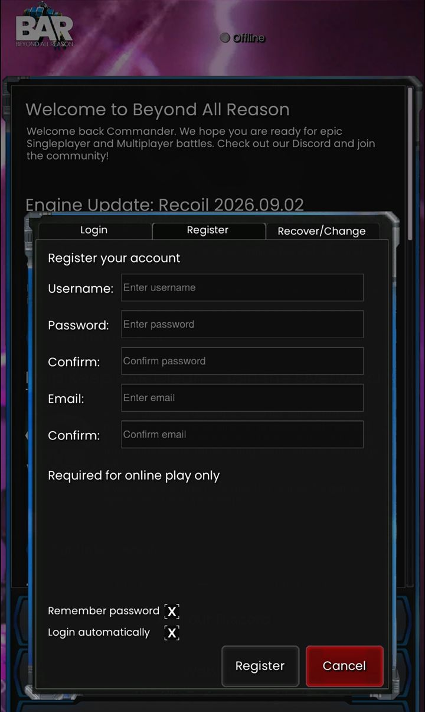

- To play online, you need a BAR account. Register one here (a username, a password and an email), or use the **Login** tab if you have one.
- Tick **Remember password** and **Login automatically** if you want the lobby to log in by itself next time.
- To play offline only, tap **Cancel**. An account is required for online play only.

> **Note:** BAR's server allows one session per account. If you log in on a PC with the same account, the phone's session ends, and the other way round.

### Finding your way around

- **Upright:** the lobby's buttons sit under the screen in pages of six. The first page has Multiplayer, Skirmish, Scenarios, Settings, Chat and Friends. Swipe the row or tap the arrows for the next page (Load Game, Replays, Downloads, Login and more). Notes show above the buttons.
- **Sideways:** all the buttons, Keys, Website and Login too, sit in one column of large buttons on the left. Swipe up or down for the next page. The screens beside the column take the whole height.

Touch in the lobby:

| You do | The lobby does |
|---|---|
| Drag on a list | Scrolls it |
| Tap a server | Shows its details first |
| Tap a text box (chat, server search, login) | Brings up Android's keyboard |
| Long press on a chat's text box | Speak to chat: what you say goes into that chat |

The lobby's Settings rows stand further apart, with taller sliders, lists and checkboxes. Upright, Replays fits each team's names to its column, and Plugins' buttons are finger sized.

### Skirmish against the AI

You can start a skirmish two ways:

- On the launcher, tap **Play vs AI**. It starts at once on the map set under "Map for Play vs AI".
- In the lobby, tap **Skirmish**. BAR's quick skirmish asks a few things, one page each: the game type, the difficulty, your faction and the map (four maps to pick from). Tap **Next** to go on. **Back** and **Advanced** sit at the foot of each page.

In BAR's skirmish room you can add AI players with **Add AI**, pick another map with **Change Map** and start with **Start**.

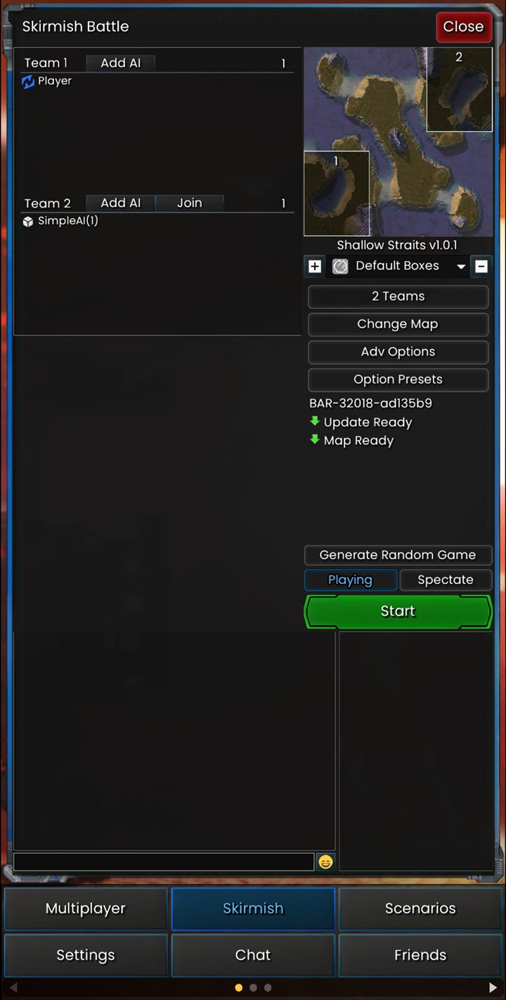

### Online games

Tap **Multiplayer** to see the servers. Tap a server to see its details, then join it. Joining a game that is already running catches up first: the screen shows how long that has left.

Some hosts change settings that affect the app's controls. With BAR's official engine, the lobby tells you when you join such a server: in red when custom widgets are off or Anonymous Mode is on (no touch or gamepad controls unless you spectate), in amber when unit control widgets are off (first person, auto retreat and presets stop). With the phone engine, the app's controls load as part of the game, so neither setting turns them off and no warning shows.

> **Tip:** Upright, the "Waiting for server response" screen fits the phone and has a **Free memory** button (on Galaxy phones). Use it before a big online game.

### Saved games and replays

- **Load Game** lists your saved games with their map, date and game version. Tap **Load** to continue one. The game starts with your commander picked and the camera on it. **Delete** removes a save.
- **Replays** lists the games you played or watched. Tap **Start** to watch one. **Add** opens Android's file picker in Downloads: pick replays (`.sdfz` files) you downloaded from BAR's website, and the app copies them into the list.

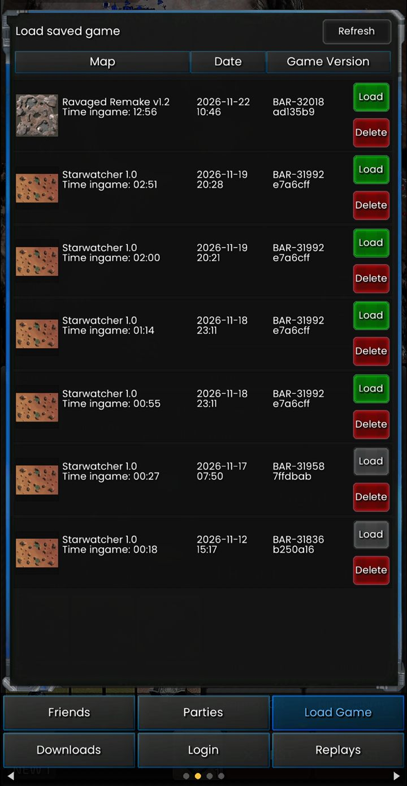

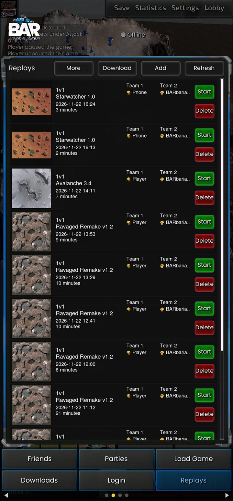

### The lobby over a running game

In a game, the top bar's **Lobby** button opens the lobby over the game. Upright and sideways, **Return to Battle** comes first and **Leave Battle** sits with the other buttons. While the lobby is open, your fingers belong to it: its lists scroll, the game behind it stays as it was, and the touch dock steps aside until you return.

### The gamepad in the lobby

A gamepad works as a mouse in the lobby. The D-pad moves the pointer to the next button, tab, list row or box in that direction, ringed in gold. **A** clicks it. **Start** switches the lobby's size between 100% and 130%.

---

## Your first game in 10 minutes

This walk-through uses the upright dock. The other screen shapes have the same buttons in other places; see [The touch dock](#the-touch-dock).

**Before you start:** to play upright, hold the phone upright. With the phone's auto-rotate on, the game turns with the phone. With auto-rotate off, turn on **Play upright** in the launcher.

1. **Start a game.** On the launcher, tap **Play vs AI**. On Galaxy phones a **Free memory** button shows while BAR loads. It opens Device care, where Memory, Clean now closes other apps. Press Back to return to the loading game.
2. **Find your commander.** The game starts with the camera on your start. Tap **COMMANDER** on the dock, or swipe down with three fingers. The commander is picked and the camera goes to it. The dock now shows its build grid on the left and its orders on the right (picture below).
3. **Build metal extractors.** Hold a tile in the build grid to see its name. Tap the **Metal Extractor**. With the commander picked, the app queues every free metal spot in the commander's weapon range at once (auto mex). The commander walks to them and builds them.
4. **Build energy.** Tap the wind half of the small pill at the top of the dock to see the map's wind. BAR's advice is shown there: Solar Collectors are better when the average wind is low. Pick a **Wind Turbine** or a **Solar Collector**. Tap the map where it should go, then tap **PLACE**.
5. **Place several in a row.** Tap **QUEUE** (at the right of the selection row) so it turns gold. Now each PLACE adds to the commander's queue, and the building stays picked for the next spot. Tap a spot, PLACE, tap a spot, PLACE.
6. **Build a factory.** Pick a **Bot Lab** in the build grid, tap a spot near your start, then PLACE.
7. **Make units.** When the lab is finished, tap **FACTORIES** on the home buttons (tap the map's empty ground first to let go of the commander). Wait a moment and the lab is picked, with its build options on the left. Tap a unit picture to queue one. Make two or three **Construction Bots** first, then combat units.
8. **Expand.** Pick a Construction Bot (its tile sits at the right end of the bottom row while it is idle) and build more metal extractors and energy.
9. **Attack.** Tap **ALL UNITS** to pick every combat unit. Tap **Fight**, then tap the map where they should go. They attack what they meet on the way.
10. **Win.** In the skirmishes tested, the game ended when the enemy commander died ("Kill all enemy Commanders"). BAR shows "Victory!" and its Awards. The chat says BAR will leave the game in 12 seconds; tap the screen to stay longer.

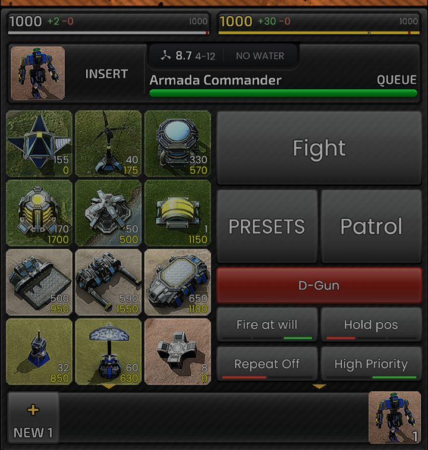

> **Tip:** Tap **PAUSE** on the home buttons (nothing picked) to pause a game of your own. It shows "PAUSED" in gold while paused. Online, with other players, there is no PAUSE.

> **Tip:** Keep your commander out of the front line, and build anti-air early if the enemy has aircraft. In the touch playtests, enemy aircraft killed a commander that had no anti-air near it.

> **Tip:** Leave gaps between energy converters. One exploding can take the ones beside it.

> **Tip:** After a fight, use an area **Reclaim** on the wrecks. It gives a lot of metal, and wrecks you reclaim cannot be raised by the enemy.

---

## The touch dock

The touch dock is the app's own panel for playing with your fingers. It holds the build grid, the orders, metal and energy, the unit groups and more, in large buttons. It looks like BAR's own interface: BAR's panels, buttons and unit tiles.

The dock shows:

- **Upright** on a tall phone: across the bottom, the game above it.
- **Unfolded** on a near-square screen, such as an unfolded Galaxy Fold: split into two blocks in the bottom corners.
- **Sideways**, with the launcher setting "Touch dock sideways" on (it is on by default): in one bottom corner, for one thumb.

Sideways, a gamepad or a mouse brings back BAR's own screen layout. Touch the screen and the dock returns.

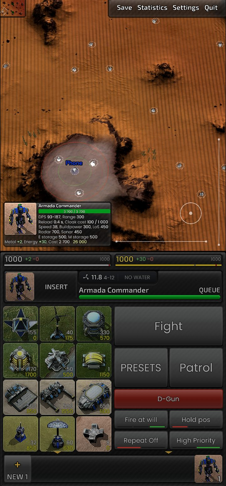

### How the dock works

**Two modes.** At rest the dock is a camera pad: your finger on it moves the camera. A tap opens its menu, with a quick blink to show it is ready. The menu stays open for 2.6 seconds after your last touch, then the dock goes back to being a camera pad. While a building is being placed, the menu stays open.

**The camera pad:**

| On the dock | Does |
|---|---|
| Drag | Pan the map |
| Double tap and hold, then move up or down | Zoom |
| Double tap and hold, then move sideways | Turn the camera |
| Triple tap and hold, then move up or down | Tilt the camera |
| Tap | Open the menu |

**First-tap buttons.** Many parts act on the first tap, without opening the menu first: the build grid, the orders, QUEUE and INSERT, the home buttons (and the spectator's), metal and energy, the wind and tide pill, the groups row, and sideways the tabs and the arrow. Everywhere else, the first tap opens the menu.

**Feedback.** Taps on the dock answer with a light vibration. Hold your finger on a tile and its name and role show until you lift it.

**Scrolling.** The build grid and the orders scroll up and down by whole rows. A quick flick brings the next page. A slow drag settles on the nearest row. No row is ever left half in sight.

**Android's Back** puts away what is open first: units picked, an order or building armed, a panel. When nothing is left, Back opens BAR's quit question. In a game you started from the lobby, it opens the lobby over the game instead.

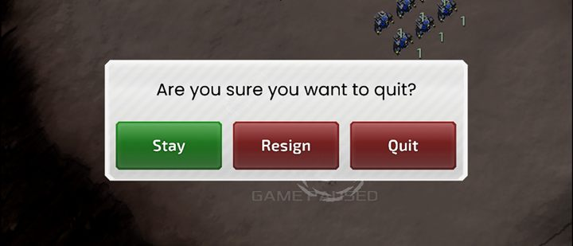

### Upright: a tall phone

Held upright, the game is on top and the dock fills the lower part of the screen.

From top to bottom:

- **Metal and energy** on the dock's top edge: the amount, the income (+) and use (-), and the storage. Tap one to open its bar. See [Economy](#economy-metal-energy-wind-and-tide).
- **The wind and tide pill**, sunk into the dock: the wind's speed and the map's range, and the tide (or NO WATER). With units picked it sits at the top of the selection row; with nothing picked, between metal and energy.
- **The selection row** (with units picked): the unit's picture, **INSERT**, the unit's name and how many are picked ("9 units, 6 of this type"), a health bar, and **QUEUE**.
- **Left half**: a builder's or factory's build grid, 3 wide. For units that build nothing, the picked units by type.
- **Right half**: the orders, 2 wide. **Fight**, **PRESETS** and **Patrol** come first and largest, the **D-Gun** in red. State buttons show BAR's lights: red on the left, yellow in the middle, green on the right.
- **The groups row** at the bottom: your control groups, **+ NEW**, and at the right end the idle builders.

With nothing picked, the dock shows the home buttons:

| Button | What it does |
|---|---|
| LOCAL UNITS | Picks every combat unit on the screen and lists them by type |
| ALL UNITS | Picks every combat unit you have and lists them by type |
| FACTORIES | Brings the camera to your factories one by one; stop tapping and the one shown is picked |
| LAST PINGS | Brings the camera to the last pings from other players and to your units under attack |
| PING | Tap, then tap the map: a ping there. Hold and speak: a ping with your words. Tap twice: speak to chat |
| COMMANDER | Picks your commander and brings the camera to it; tap again for the next commander |
| BASE | Brings the camera to your start spot |
| AUTO RETREAT | Turns auto retreat on or off (RETREAT beside PAUSE in a game of your own) |
| PAUSE | Pauses a game of your own; not there online with other players |

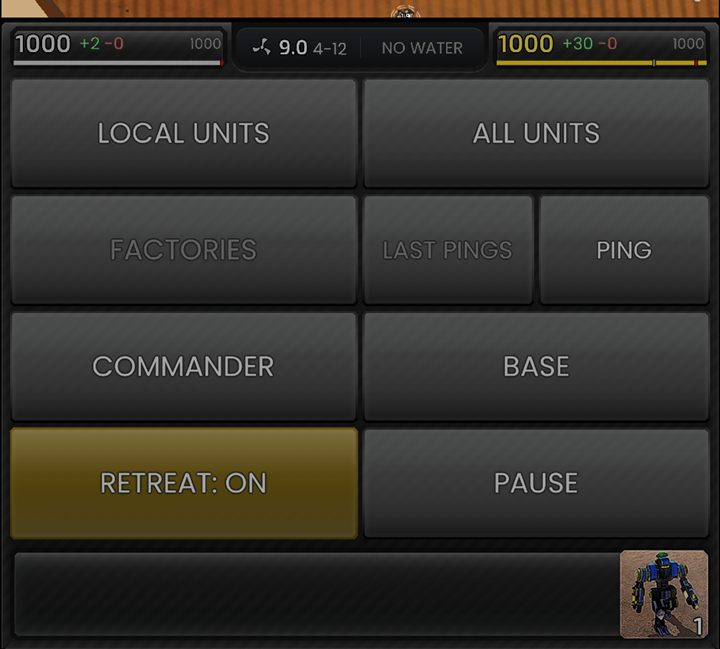

When you pick units that build nothing, the orders that would need scrolling move to the empty left side, under the unit types. The type tiles are as tall as the Fight button beside them.

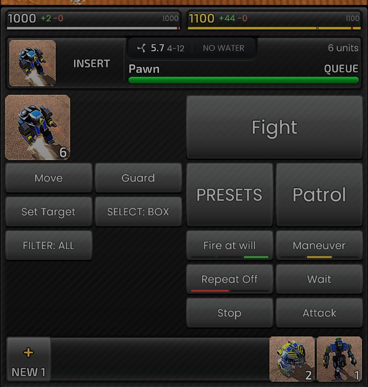

### Unfolded: the split dock

On a near-square screen, such as an unfolded Galaxy Fold held either way up, the dock splits into two blocks in the bottom corners, one under each thumb. The game shows between them.

- **The left block:** metal and energy over the build grid.
- **The right block:** the selection row over the orders.
- **Between them at the bottom:** the unit groups, the wind and tide pill, and (when it is open) the unit info panel above the pill.

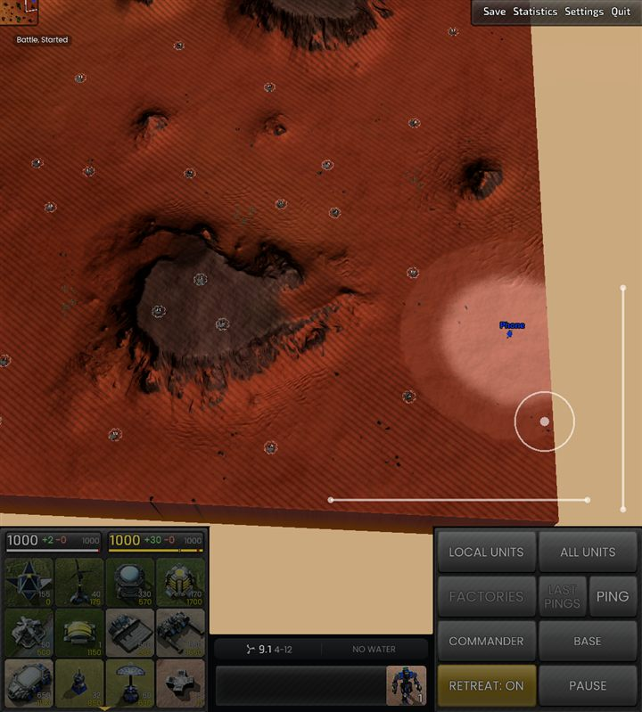

With nothing picked, the left block keeps the build grid of the builder you picked last (or your commander's), dimmed. Tap a building there and that builder is picked and its placing starts at once. The right block holds the home buttons.

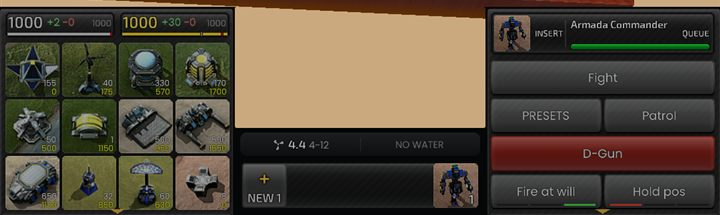

### Sideways: the one-thumb dock

Held sideways with "Touch dock sideways" on, the dock sits at one side of the bottom of the screen, for one thumb. The rest of the screen is the game's.

- **The panel** next to the screen's edge, for the units you picked. Its tabs are **BUILD | ORDERS** for a builder (it opens on BUILD), **UNITS | ORDERS** for units that build nothing (it opens on ORDERS), and **PLACE** while a building is picked. Swipe sideways on the panel to change the tab. With nothing picked, the panel holds the home buttons.
- **Beside it:** metal and energy, BAR's minimap (tap it to move the camera), the wind and tide boxes, and the unit groups.
- **The arrow** moves the whole dock to the other side of the screen, for the other hand. The app keeps your choice for the next game.

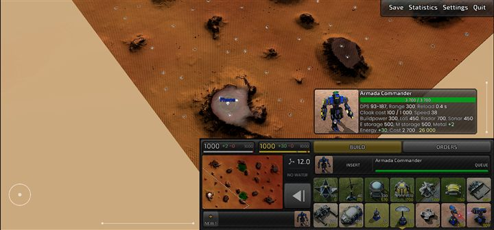

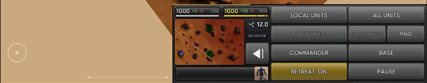

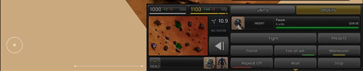

### Before the game starts

In games where you pick a start spot and queue buildings before the start, the dock shows the pre-game buttons:

- The hint "START SPOT: tap the map for yours". After you pick a spot it says "Start spot picked: queue buildings, then Ready".
- The build grid, to queue your first buildings.
- **QUEUE**, so that each building you place joins the queue instead of replacing it.
- **UNDO LAST** takes the last queued building off. **CLEAR QUEUE** takes all of them off.
- Your factions: **ARMADA**, **CORTEX**, **LEGION** and **RANDOM**, as the game allows.
- **PING**, which works as on the home buttons.

If you already queued buildings, a faction tap asks first: "TAP ARMADA AGAIN TO SWITCH: THE QUEUE CHANGES WITH IT". Tap it again to switch.

> **Tip:** Before the start, a map tap with no building picked moves your start spot. Pick the building again before you tap the map.

### Turning the phone

With the launcher setting **Turn with the phone** on (the default) and the phone's auto-rotate on, the lobby and the game turn upright or sideways as you hold the phone, at any time, even mid-game. BAR's interface takes a moment to redraw at the new shape: about a second with the phone engine, 5 to 10 seconds with BAR's official engine. With auto-rotate off, the setting **Play upright** decides.

BAR's interface scale follows the screen: 2.0 on a folded phone held sideways, 1.0 on a folded phone held upright and on an unfolded screen.

### For pros: the dock

- QUEUE and INSERT can be on together: that is Shift and Alt held, as in BAR. Both turn off once nothing is picked.
- A tap on the dock just as its buttons change (the selection gone, say) is dropped for a moment, so it does not land on a different button.
- The groups row scrolls sideways when your groups and idle builders do not fit.
- On the unfolded dock, the dimmed build grid is the fastest way to start a building: one tap picks the builder and the building together.

---

## Touch gestures on the game

These gestures work on the game itself (the map), in every screen shape.

| Gesture | In the game |
|---|---|
| Tap | Click: select a unit, press a button, place a building |
| Double tap on a unit | Pick every unit of that type on the screen |
| Triple tap on a unit | Pick every unit of that type on the whole map |
| Drag | Pan the map. A flick glides. On BAR's minimap and sliders it drags them. Up or down in BAR's Settings, Statistics and other windows it scrolls them |
| Tap, then drag | Box select |
| Long press | Right click: move, attack, the smart order. Keep dragging for a path (one unit) or a formation line (more units) |
| Two-finger tap | Right click |
| Two fingers | Move to pan, pinch to zoom, twist to turn. Move both up or down together to tilt |
| Two fingers held, then swipe | Up: select all your units. Down: deselect. Left: stop. Right: fight |
| Three-finger tap | Speak to chat |
| Three-finger double tap | Show or hide the keyboard |
| Three-finger swipe | Up: the whole map. Down: the camera to your commander, which is picked (if it is dead, the constructor you picked last). Left or right: previous or next idle builder |
| Three fingers held | The layout editor |

With the dock up, a one-finger drag on the game pans the map even with units picked. To draw a path, hold, then drag. With **Move**, **Fight** or **Patrol** pressed on the dock, a drag draws the path at once.

> **Note:** The launcher setting **BAR touch controls** turns these gestures on (the default). Off, your fingers work as the display server's touch modes, found under **Display**.

---

## The camera

### Moving the camera

- **Pan:** drag one finger on the map. A flick glides on.
- **Zoom:** pinch with two fingers. The zoom is smooth, centred on your fingers.
- **Turn:** twist two fingers.
- **Tilt:** move two fingers up or down together.
- **Jump:** tap BAR's minimap. Upright, the minimap waits small, as tall as BAR's top bar; unfolded and held sideways, at half size. The first tap only opens it to full size; it shrinks again 7 seconds after your last tap on it.
- **The whole map:** swipe up with three fingers.
- **Your commander:** swipe down with three fingers, or tap **COMMANDER**.
- **Your start:** tap **BASE**.
- **The dock's camera pad:** drag on the dock at rest. Double tap and hold, then move up or down to zoom, sideways to turn. Triple tap and hold to tilt.

Past the map's edge the camera moves as it does on the map. A drag over the sky (the camera tilted up to the horizon) still moves the map.

### The camera knob and the edge rails

The one-finger camera gives you zoom and turn without a second finger. It has two parts. Both work only in a game.

- **The camera knob:** a thin ring over the map. Hold it and slide. Your first slide decides what it does: up or down zooms (down goes closer), sideways turns.
- **The edge rails:** with the touch dock up, two thin lines in an L at the map's bottom corner, each half as long as the side it sits on. Slide along the upright rail to zoom. Slide along the rail at the foot to turn.

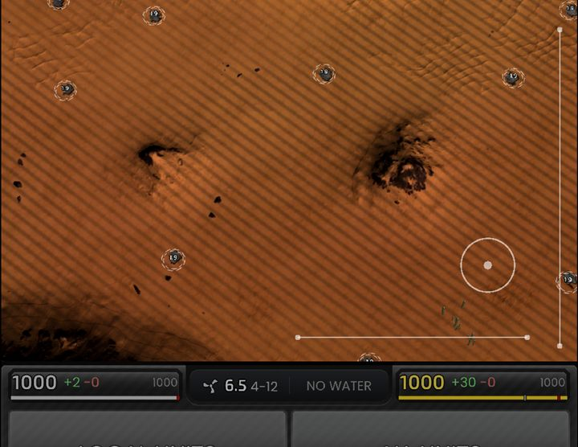

Both light up gold while you hold them. The speed of your finger counts: a slow drag makes fine steps, a fast one makes big ones. A tap on the knob or a rail, with no drag, goes to the map under it.

**Settings.** In a game, open BAR's **Settings**, tab **Control** (tab **Custom** with the phone engine off), section **Camera with one finger**:

| Setting | What it does |
|---|---|
| Camera knob | Shows the knob over the map |
| Camera edge rails | Shows the rails while the touch dock is up |
| Controls on the left | Puts the rails and the knob on the left side, for the left hand |
| Controls colour | White, or the touch dock's own grey |
| Controls sensitivity | How far a drag zooms or turns, from 0.5 to 2 |

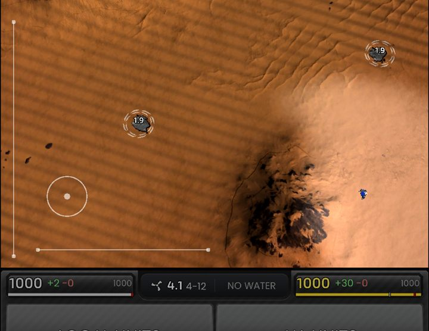

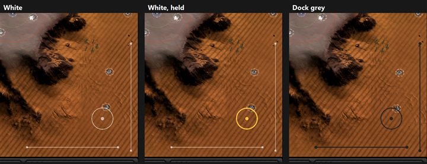

The knob and the rails hide while they would be in the way: with BAR's Statistics or a scenario's Mission Info open, in the layout editor, on BAR's quit screen, and while a gamepad or a mouse is the input.

### For pros: the camera

- Move or resize the knob in the layout editor. It is listed there as "Camera knob". Put it where your thumb rests and away from where you place buildings.
- Raise **Controls sensitivity** if you play on big maps and zoom out often. Lower it for fine control.
- Turn the rails off if you never use them. The knob alone is enough for many players.
- Three-finger swipes up and down are the fastest way between the overview and your commander.

---

## Selecting units

### The basics

| To pick | Do this |
|---|---|
| One unit | Tap it |
| Nothing | Tap empty ground |
| Every unit of one type on the screen | Double tap one of them |
| Every unit of one type on the map | Triple tap one of them |
| Units in an area | Tap, then drag a box |
| All your units | Hold two fingers, then swipe up |
| Every combat unit on the screen | Tap LOCAL UNITS |
| Every combat unit you have | Tap ALL UNITS |
| Your commander | Tap COMMANDER, or swipe down with three fingers |
| An idle builder | Tap its tile at the right end of the groups row, or swipe left or right with three fingers |
| A control group | Tap its picture in the groups row |

### Box and circle select

Tap, then drag on the map to select. With the dock up, two switches change how this works. They show among the orders while units are picked.

- **SELECT: BOX** or **SELECT: CIRCLE**: tap it to switch between a box and a circle.
- **FILTER: ALL**: tap it to step through the filters for the next selection: ALL, BUILDERS, COMBAT, AIR, NAVAL.

While you drag a selection, the dock shows the filters. Touch one with a second finger to pick it; it stays picked for your next selections too.

> **Tip:** A box picks units, not buildings. That makes it the most reliable way to pick constructors that stand between buildings.

### LOCAL UNITS and ALL UNITS

**LOCAL UNITS** picks every combat unit on the screen. **ALL UNITS** picks every combat unit you have. Armed aircraft are included; builders are not. The left half then lists them by type, with the orders beside them.

- The list's first tile is an **ALL / MULTI** switch.
- With **ALL** on, tap a type to pick that type alone.
- Tap the switch for **MULTI**: everyone is let go, and each type you tap joins the pick (it turns gold). Tap the switch again for ALL: the whole list is picked again.
- **Hold a type's picture** to leave that type out of ALL's picks. Its tile is crossed out. Hold it again to bring it back. The list's last type always stays in.

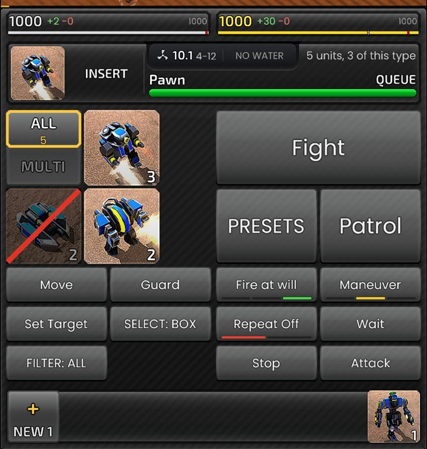

### Control groups

The groups row at the bottom of the dock shows your control groups as pictures: each group's most common unit, its number on a dark badge, and how many units it has.

- **Make a group:** pick units, then tap **+ NEW** (it shows the next free number, such as "NEW 2"). The types you picked become that group, the units you have now and the ones you make later. This is BAR's own Auto Group.
- **Pick a group:** tap its picture.
- **Remove a group:** hold its picture. The assignment is taken off.

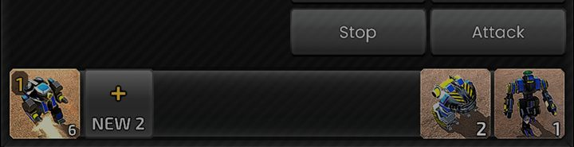

### Idle builders

At the right end of the groups row, each type of idle builder has a tile with its count. Tap one: the nearest idle builder of that type is picked and the camera goes to it, zoomed in. Tap again for the next one. A three-finger swipe left or right steps through all your idle builders, any type, and moves the camera to each.

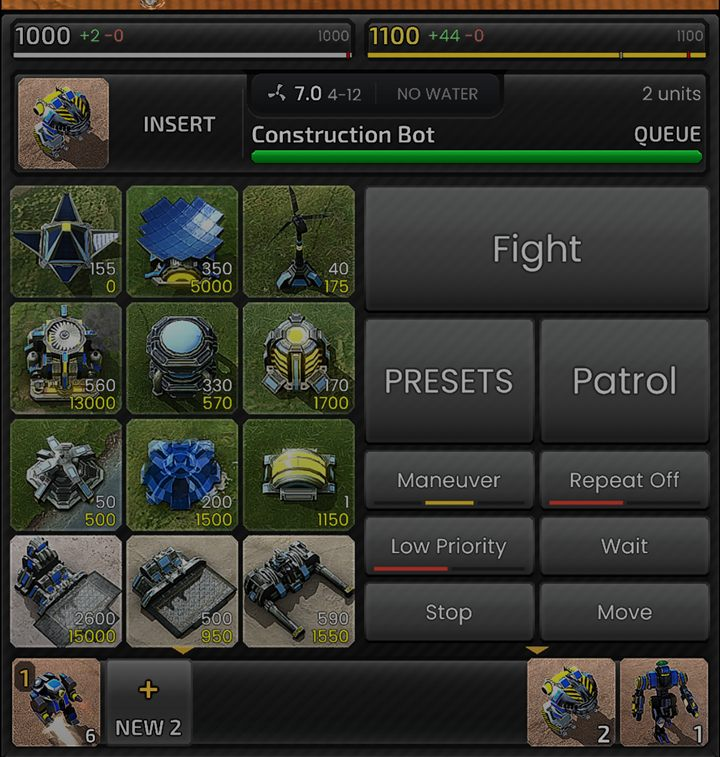

> **Note:** With **QUEUE** on, a tap on a unit adds it to what is picked, as Shift-click does in BAR. Turn QUEUE off to pick a unit alone.

> **Tip:** A tap on the middle of a factory can pick the unit being built in its yard. Tap the back edge of the factory instead.

### For pros: selecting

- Leave a type out of ALL UNITS (hold its picture) to keep scouts or artillery out of your main army's picks for the whole game.
- Use MULTI to give one order to two or three unit types and leave the rest where they are.
- Because groups are made by type, new units of that type join the group as they come out of the factory. Make a group for your main army type early.
- LOCAL UNITS over a screen where only left-out types stand brings those types back into ALL's picks, so the list is never empty.

---

## Giving orders

### The quick way: a long press

A long press on the map is BAR's right click: the smart order. On the ground, the picked units move there. On an enemy, they attack it. On a damaged unit, builders repair it.

- Keep your finger down and drag: one unit follows the path you draw, more units spread along the line you draw.
- With **QUEUE** on, a long press on the ground queues a move after the units' other orders.
- A two-finger tap is a right click too.
- Hold two fingers, then swipe left to stop, right to fight.

### The order buttons

With units picked, the dock's right half shows their orders. They are BAR's own orders.

| Button | What it does |
|---|---|
| Fight | Move and attack anything on the way (attack-move). Builders repair and reclaim on the way |
| PRESETS | Formations and strafing; see below. It takes MOVE's big place for any units that move |
| Patrol | Go back and forth between here and there, fighting on the way |
| D-Gun | The commander's D-gun mode (red) |
| Move | Move there, no stopping to fight |
| Attack | Attack a unit or a spot |
| Guard | Follow and protect a unit |
| Set Target | Keep aiming at a target while doing other orders |
| Stop, Wait | Stop all orders; pause the current one |
| Repair, Reclaim, Restore, Area Mex | Builder orders |
| State buttons | Fire at will, Hold pos, Maneuver, Repeat, Low Priority and others. Each tap steps to the next state; BAR's lights under the word show which |

To give an order that needs a target: tap the order, then tap the map or a unit. With **Move**, **Fight** or **Patrol** pressed, a drag on the map draws the path at once.

**Area orders** (Area Mex, Reclaim, Repair, Restore, Capture, Load units): tap the order, then drag on the map from the middle outwards to draw BAR's circle. A tap on the map, then a drag, works too. With QUEUE on, the order stays armed after the drag, so you can draw another circle.

### QUEUE and INSERT

The selection row has two switches:

- **QUEUE** (right): the next order joins the end of the units' queue. It is a sticky Shift key for your fingers.
- **INSERT** (left): the next order goes to the front of the queue. It is BAR's Space key (Command Insert).

Both can be on together. Both turn off once nothing is picked. While a building is picked, the PLACE button says "+ QUEUE" or "+ INSERT" in its corner when they are on.

> **Note:** An order given without QUEUE replaces the units' orders, as a mouse click does in BAR. A Move given to the commander without QUEUE drops its whole build queue.

### Removing queued orders

While the picked units have orders, two buttons show at the right end of the groups row: **× FIRST** takes their first order off, **× LAST** takes their last order off. For a factory, they work on its build queue.

### Giving units to a teammate

In a team game, **TRANSFER** shows among the orders. Tap it, then tap the teammate who gets the picked units. **CANCEL** closes the list.

### Presets: formations and strafing

PRESETS sends the picked units in a formation. It shows in MOVE's big place when units that move are picked (builders and commanders too).

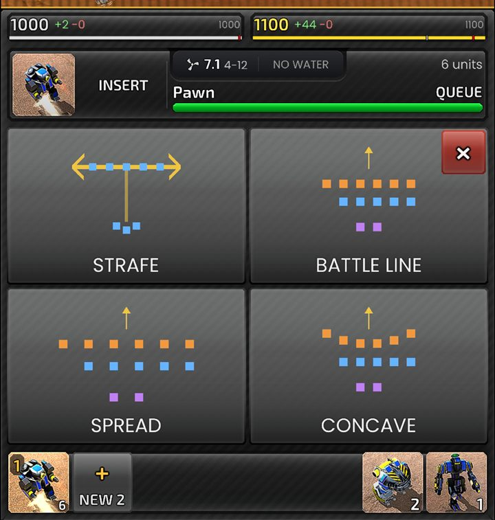

| Preset | What the units do |
|---|---|
| STRAFE | A line abreast, gaps between the units where there is room. Each unit fights its way to its place |
| BATTLE LINE | Formed up by role: short-ranged units in front, ranged units behind by their reach, so they can all fire past the front |
| SPREAD | The same idea with wider gaps between units and rows |
| CONCAVE | The same, with the ends of the line forward |

In the formations, the units form up where they stand, facing the destination, then move there as one at the slowest unit's speed, so the artillery stays at the back. Aircraft form their own group, fighters ahead of bombers and transports.

Once each unit reaches its place, it moves side to side across it on repeat, fighting, without waiting for the others. That makes them harder to hit. Aircraft only go to their places.

**To send a preset:**

1. Pick the units.
2. Tap **PRESETS**. The four presets cover the dock.
3. Tap one. The dock says, for example, "STRAFE: TAP WHERE TO SEND".
4. Tap the map where they should go. A drag pans the map instead.

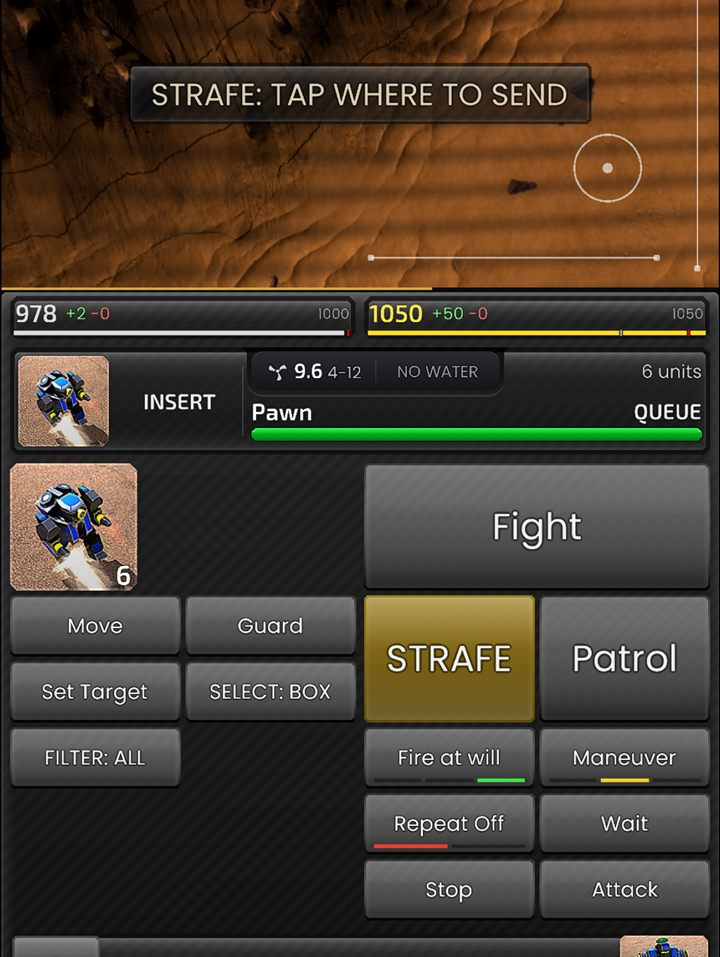

To cancel, tap the X in the corner, or press Android's Back ("PRESET CANCELLED").

### For pros: orders

- **Presets with QUEUE:** turn QUEUE on, pick a preset, then tap several places in turn. The units go to the first, wait there for each other, then go on to the next. They go side to side only at the last place.
- **Presets with INSERT:** the formation goes to the front of their orders; their own orders follow after.
- **A factory's preset:** pick a factory, tap its PRESETS and send it to a place. From then on its new units gather there in that formation; see [Factories](#factories).
- **Paths:** hold, then drag with many units picked to spread them along a front line. With Fight pressed first, the line is a fight line.
- **Waypoints for a push:** QUEUE on, Fight, tap three or four points along the route. The army fights through each in turn.
- **A Patrol loop** over your base's ways in, for a group of combat units, answers raids by itself while you build.

---

## Building

### Placing one building

1. Pick a builder (for example your commander).
2. Tap a building in the build grid. The picked building is framed in gold. The right half shows **ONE · LINE · GRID · BORDER** and a big green **PLACE** button with **ROTATE** and **X** under it.
3. Tap the map where it should go. The building shows there, and PLACE turns bright green.
4. Tap **PLACE**.

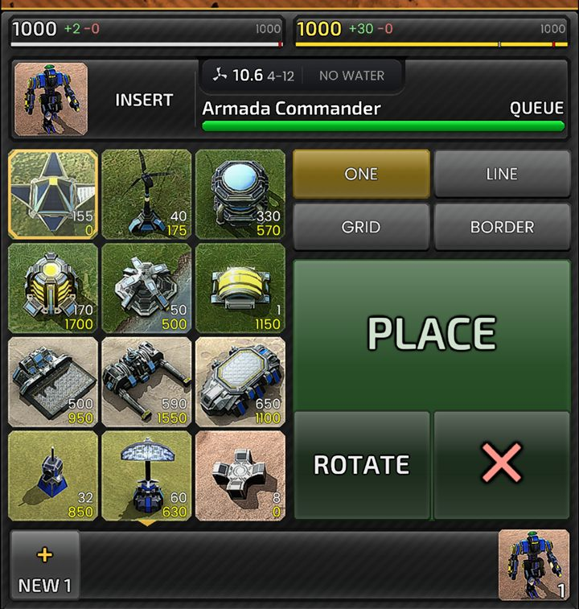

Without QUEUE, PLACE works like a mouse click: the building replaces the builder's orders, and the building is let go. With QUEUE on, the building joins the builder's queue and stays picked for the next spot.

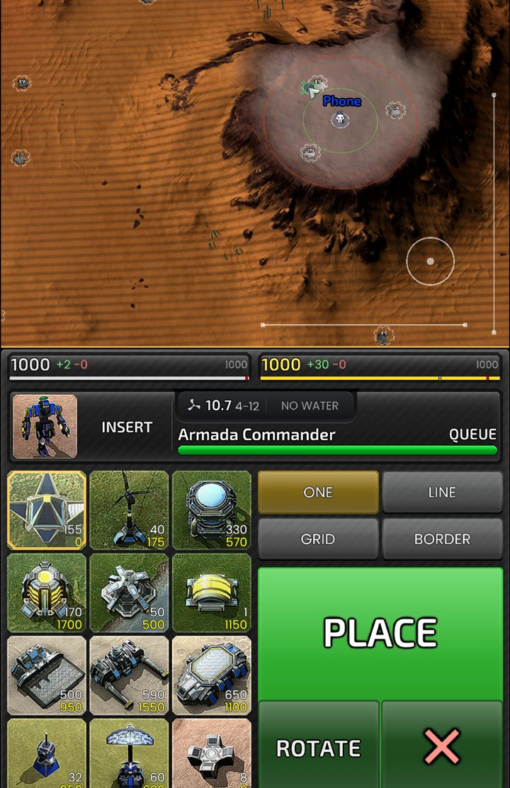

**Fine placing with ONE.** With ONE, a drag on the map does not pan. The building follows your finger, slowly at first for fine placing. Once it waits on the map:

- A later drag anywhere nudges it: slowly at first, faster as your finger moves farther.
- A tap elsewhere moves it there.
- A double tap sends it, like PLACE.
- With none waiting, a double tap places one there and sends it at once.

Two fingers still pan and zoom while you place.

- **ROTATE** turns the building a quarter turn.
- **X** puts the building away. With LINE, GRID or BORDER, a long press on the map starts that shape there: drag to its far corner, then tap PLACE.
- If BAR refuses the spot, the dock says "CAN'T BUILD THERE: PICK ANOTHER SPOT".

> **Tip:** Not sure which tile is which? Hold your finger on a tile: its name and role show until you lift it.

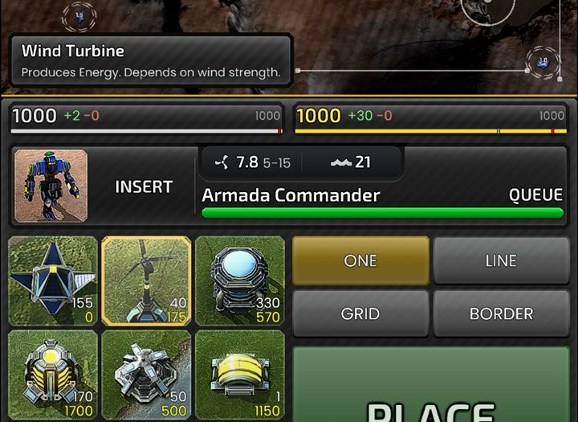

### Rows, areas and rings: LINE, GRID, BORDER

Pick the shape, then drag on the map:

- **LINE:** a row of the building along your drag.
- **GRID:** a filled area of them.
- **BORDER:** a hollow ring of them.

They are placed at once, with BAR's own line and area building.

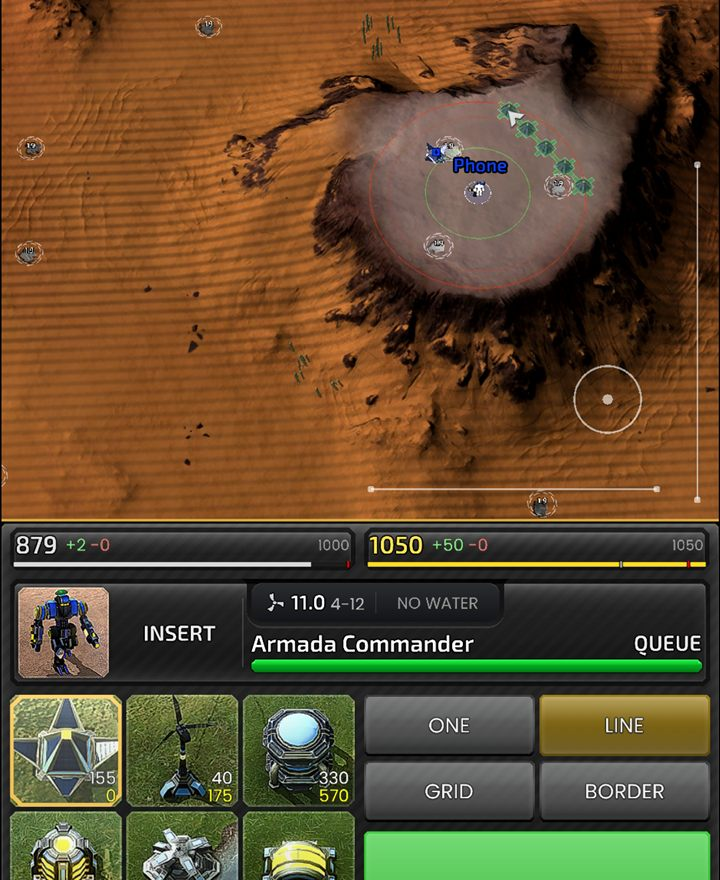

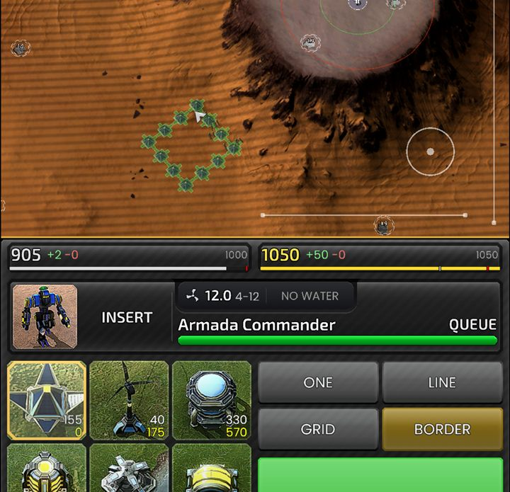

**A GRID from ONE.** With ONE, hold your finger still on the waiting building for a full second (a drag on it only nudges it). "GRID" pops up with a buzz, and your drag now draws a grid of them from there. PLACE or a double tap sends the grid. ONE during a GRID keeps it, the building waiting where the grid began; GRID or LINE brings the grid back.

> **Note:** A building's sea version (a Tidal Generator for a Solar Collector, say) is used only where your finger really taps water. This needs the phone engine.

### Walls around sentries

When you place a sentry on its own, the app queues a ring of walls around it. It picks the wall by tech level:

- A T1 sentry gets the builder's own T1 wall (Dragon's Teeth), built after the sentry.
- A T2 sentry gets the T2 wall (Fortification Walls), built before the sentry. One too low to fire over those gets Dragon's Teeth instead, from a T1 builder, at the front of its queue.

Only real sentries get walls: land defence towers that fire over the walls. Anti-air, sea defences, long-range artillery, missile and nuke silos, radar and jammers never get walls, and neither do the low pop-up turrets. A line or grid of sentries placed together gets none, because their rings would cross.

While a sentry is picked, a **WALLS** switch sits between ROTATE and X. It shows what the ring adds in metal, for example "WALLS +64". Tap it to turn the walls off or on. It is on by default and the app remembers your choice.

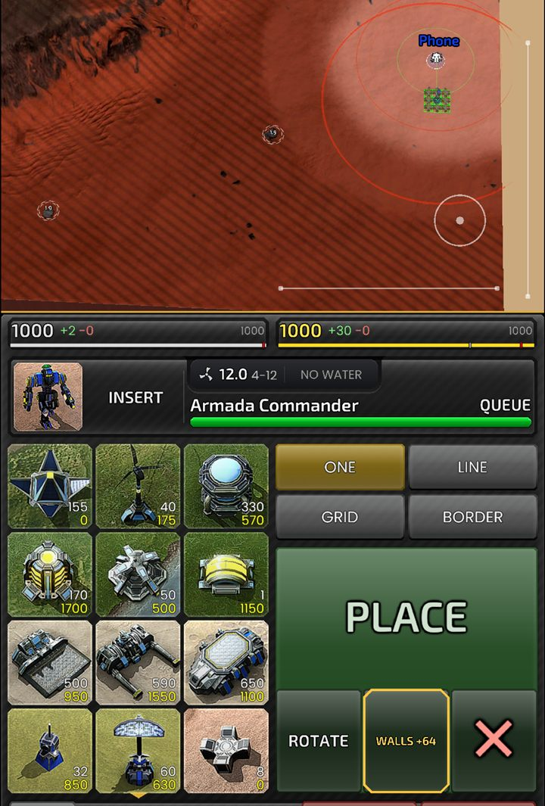

### Metal extractors: auto mex and Area Mex

**Auto mex.** Pick your commander, then pick a Metal Extractor. Every free metal spot in the commander's weapon range is queued at once, the nearest first, with no tap on the map. The extractor is then put away. If no spot is in range, nothing is queued and the extractor stays picked for you to place.

> **Tip:** To place an extractor farther away after auto mex, pick the Metal Extractor again, then tap the far spot.

**Area Mex** is BAR's own order for builders. Tap **Area Mex** among the orders, then drag out a circle on the map. The free metal spots in it are queued.

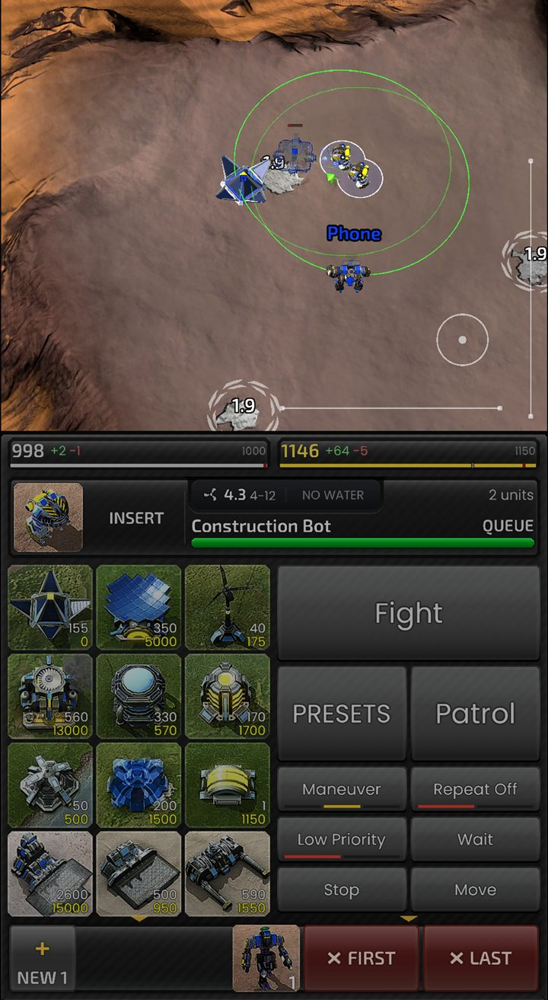

### Factories

**Find your factories.** Tap **FACTORIES** on the home buttons. The camera goes to your next factory and its name shows, for example "BOT LAB (1 OF 2)". Tap again for the next one. When you stop tapping for 0.75 seconds (a gold bar runs out along the button), the factory on screen is picked and its build menu shows.

**Queue units:**

1. Tap a unit picture: one more is queued. A long press takes one off.
2. The right half then shows that unit's queue buttons: **+1**, **+5**, **+20**, **-1**, **CLEAR** (all of that unit) and **ORDERS** (back to the factory's orders).
3. The count shows on the picture.

With **INSERT** on, new units go to the front of the factory's queue.

**The factory's orders.** A factory's **Fight**, **Move** and **Patrol** set where its new units go. **Repeat** makes it build its queue again and again.

**A factory's preset.** Tap the factory's **PRESETS** and pick one, then tap the map. Its new units gather there in that formation, each in its own place. The button then shows the preset, for example "PRESETS: STRAFE".

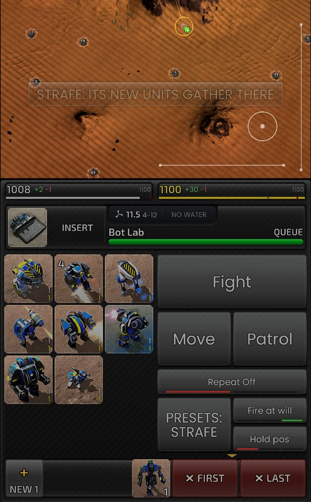

> **Note:** Repeat repeats the whole queue, constructors included. Take the constructors off (tap the constructor, then CLEAR) once you have enough.

### For pros: building

- **GRID without switching:** with ONE, hold still on the waiting building for a second to draw a grid on the spot, then double tap to send.
- **Build orders before the start:** turn QUEUE on in the pre-game dock and queue your whole opening. UNDO LAST fixes a mistake.
- **INSERT on a builder** puts the building at the front of its queue. Use it for an urgent anti-air tower.
- **Builders on Fight or Patrol** repair and reclaim on the way.
- **Converters:** leave gaps between them. A row of converters touching each other can chain-explode.
- Keep factory exits clear. Buildings placed around a factory can wall in its units.

---

## Economy: metal, energy, wind and tide

### The resource bars

Metal (grey) and energy (yellow) sit at the top of the dock. Each shows the amount, the income (+), the use (-) and the storage.

Tap one to open its bar, drawn as BAR's top bar draws it:

- The storage's fill.
- A red **share** knob: what is above it goes to your allies.
- On energy's bar, a pale **conversion** knob: energy converters turn energy into metal only while your energy storage is above this mark.

Touch the bar to move the nearer knob, in whole percents. The labels say where they stand, for example "SHARE ENERGY ABOVE 95%" and "CONVERT ABOVE 75%".

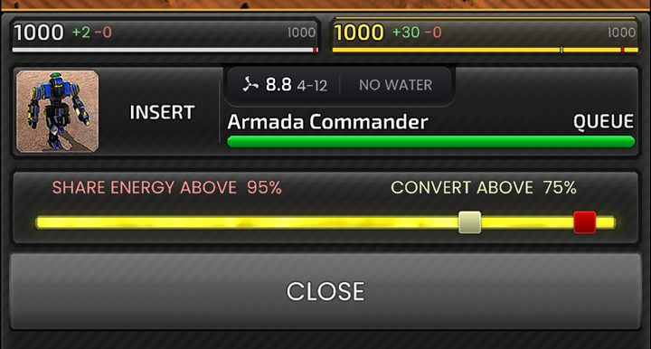

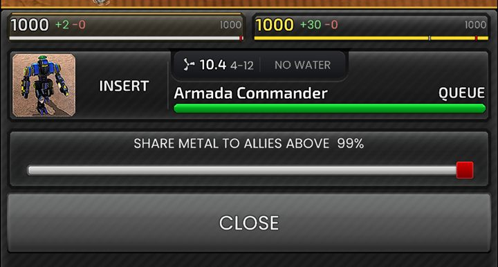

In a team game the bar also has **SEND METAL** or **SEND ENERGY**. Tap it, pick how much (10%, 25%, 50% or 100%), then tap a teammate. **CANCEL** closes the list. **CLOSE** closes the bar.

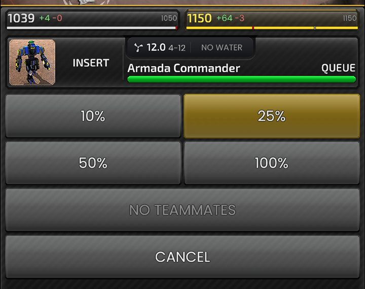

The small metal and energy boxes show the share and conversion marks on their bars. The open one's box is lit gold.

> **Tip:** If your converters stand idle, check the conversion knob. In the touch playtest, energy stayed at 60-70 % while building, under the default 75 % mark, so the converters did nothing.

### Wind and tide

The pill shows the wind's speed and the map's range (before the game starts, the range alone), and the tide. On a map without water it says NO WATER.

Tap the wind's half for BAR's own wind details: the average, lowest and highest wind, how much of the time it is under 6, BAR's advice on solar against wind, and the last five minutes as a graph. Tap the tide's half for the tide's strength. Any tap closes them.

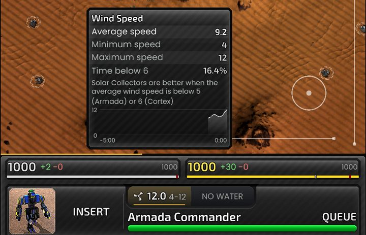

### For pros: economy

- BAR's advice in the wind details: Solar Collectors are better when the average wind is below 5 (Armada) or 6 (Cortex).
- Pull the conversion knob down if you have spare energy and need metal.
- Gamepad players have the share list (LB + D-pad up): see [Gamepad](#gamepad).

---

## The unit info panel

The unit info panel shows BAR's numbers for what you picked, as BAR's own Info panel does: the name, a health bar, DPS, range, reload, speed, sight, buildpower, metal and energy made and used, and the cost.

**Where it is:**

- **Upright on a tall phone:** on top of the dock, on the half away from the camera knob and rails.
- **Unfolded:** in the dock's middle, above the wind and tide pill.
- **Folded and sideways:** on top of the dock's panel.

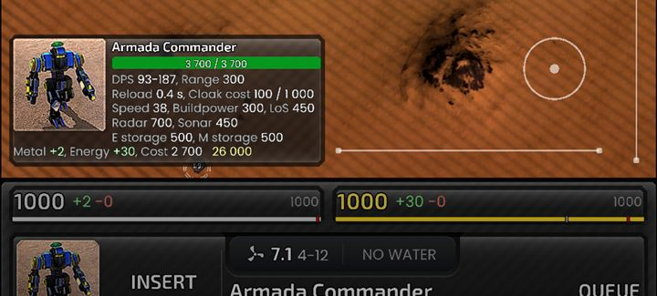

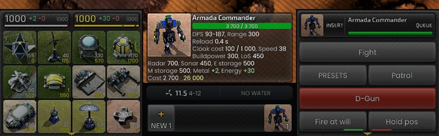

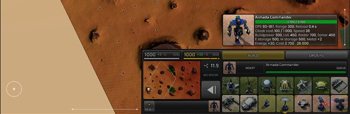

**What it shows:**

- **One unit:** its picture, name, health and stats.
- **Several units of one type:** that type's name and stats, with the count on its picture.
- **Several types:** their totals: the count, health and DPS summed, costs, buildpower, metal and energy made and used, and kills.
- **Nothing picked:** a wreck, a tree or a rock under the pointer shows its name and what reclaiming it gives. A wreck shows the picture of the unit it was.

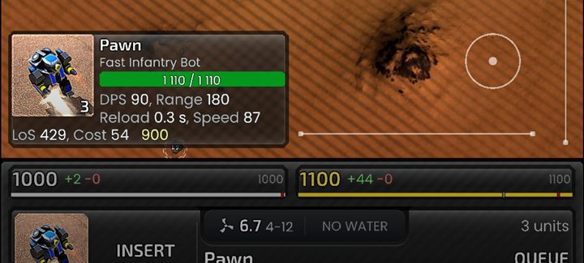

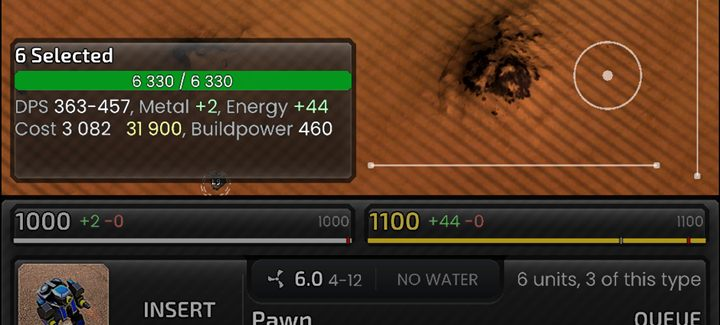

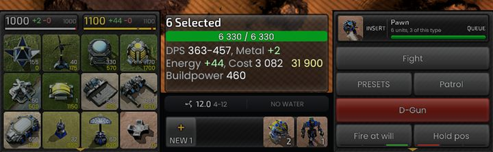

**Folding it away.** Tap the panel to fold it to a small **INFO** tab. Tap the tab to open it again. The app keeps your choice for the next game.

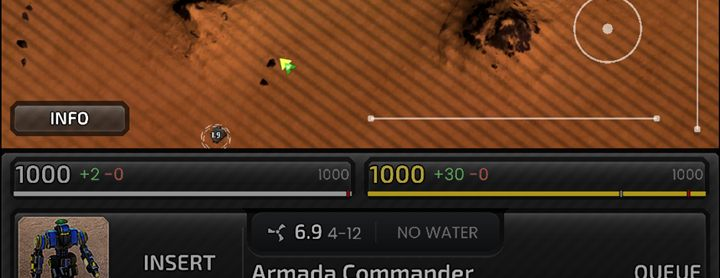

**Camera to the unit.** Tap the unit's picture in the panel to bring the camera to it.

The panel hides while you spectate, in the D-gun mode, while the wind's details are open, and while a tile's name shows. It also steps aside while a building, an order or a preset is armed, because your next tap on the map is its place. It comes back as soon as that is done.

**Without the dock** (sideways with "Touch dock sideways" off, or with a gamepad or mouse sideways), the panel sits at the bottom left, where BAR's own Info panel would be. With several types picked it shows them in a grid with counts: tap a type to keep only it, long-press a type to drop it. There you can move and size it in the layout editor. Made bigger, it stops at the order menu.

---

## Combat helpers

### The D-gun mode

The D-gun is the commander's special weapon. Pick your commander and tap the red **D-Gun** button. The dock turns into the D-gun mode:

- **MOVE** (left stick): walks the commander. Let go and it stops.
- **AIM** (right stick): aims the shot. A short flick is enough. On a turned camera it aims along the screen.
- **FIRE**: fires when you lift your finger.
- **X**: leaves the mode.

The commander stays in the middle of the screen and the camera follows it. A red line on the map shows where the shot goes. The empty space of the dock zooms (drag up or down) or turns the camera (drag sideways).

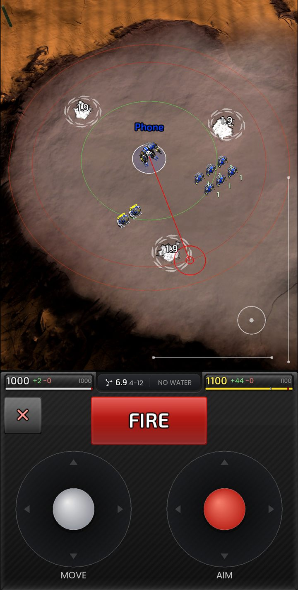

**Aim with a tap.** Tap the map and the shot aims there. Tap an enemy unit and the aim stays on it, led as it moves, with its rings on the enemy.

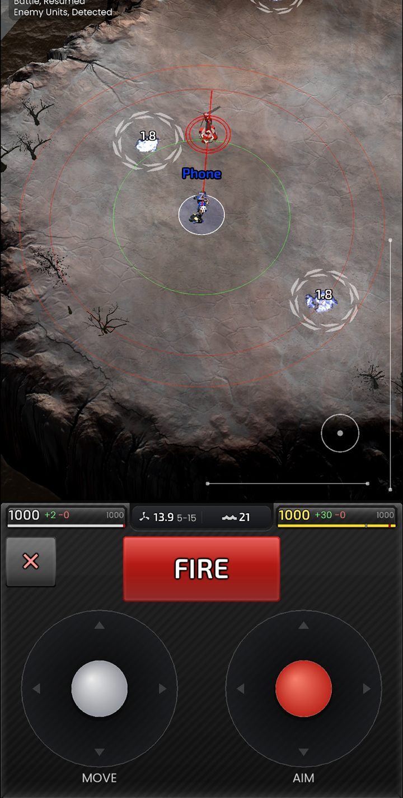

**Full auto.** Swipe **FIRE** to the right. It turns to **AUTO** and the commander fires by itself at the enemy in range most worth a shot, never through your own units. Swipe AUTO to the left to end it. Full auto works only where the host allows unit control widgets.

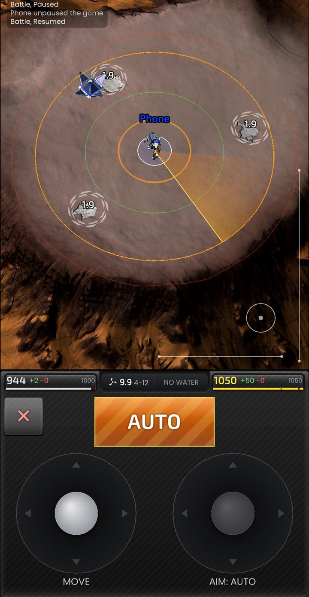

**Sideways and unfolded** the D-gun mode floats over the game: MOVE and AIM in the bottom corners, a FIRE beside each, so either thumb fires. Swipe either FIRE towards the middle for full auto, and again to end it. X at the left leaves.

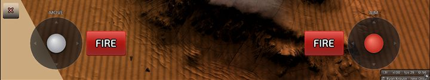

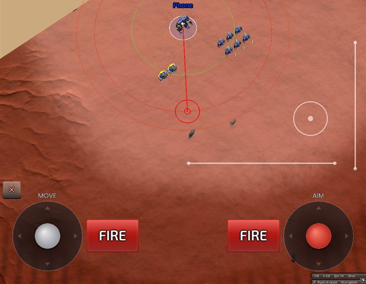

> **Note:** The D-gun uses a lot of energy for each shot. It does not kill an enemy commander: in BAR, commanders are immune to it. Save it for other units.

### Auto retreat

Auto retreat pulls hurt units out of a fight. It is on by default. Turn it on or off with **AUTO RETREAT** on the home buttons (it says "AUTO RETREAT: ON" or "AUTO RETREAT: OFF"; in a game of your own it is "RETREAT" beside PAUSE).

What it does:

- **A hurt unit** (under half health) falls back a short way, away from the nearest enemy it sees and towards your start spot. It does this once, until its health is above 60 % again. If you send it back in, it stays.
- **A hurt commander** (under half health) retreats away from the nearest enemy, past the reach of its own death blast. Your combat units near it get a fight order to cover it, then go back to where they were. Builders very near it repair it first. After that the commander waits on patrol until you give it orders. The dock says, for example, "COMMANDER RETREATING, 3 COVER".
- **A commander on your own orders** that falls under 30 % gets a warning: "COMMANDER AT 23 %: PULL IT BACK".

Where the host has turned off unit control widgets, the button says "AUTO RETREAT: OFF IN THIS GAME".

> **Tip:** Auto retreat cannot save a commander from aircraft: they outrun it. Build anti-air near your commander.

> **Tip:** In an all-in push, hurt units walking home alone can be picked off. Turn auto retreat off for the push if you want the army to stay together.

### Pings and under-attack alerts

**LAST PINGS** brings the camera to the last 4 pings from other players. Tap it again within 2 seconds for the one before. Its badge shows how many there are, and as you step back the tile shows "2 OF 4" and the note "PING 2 OF 4".

Your own units under attack are in the same list. A fight is one entry, moved along as it goes on, even when it spreads out. A new fight in another place gets its own entry within a second, however busy the first one is. When the newest entry is an attack on your units, the badge is red; tap LAST PINGS and the note says "UNDER ATTACK". BAR's own messages, such as a commander under attack, show in the chat box for 15 seconds.

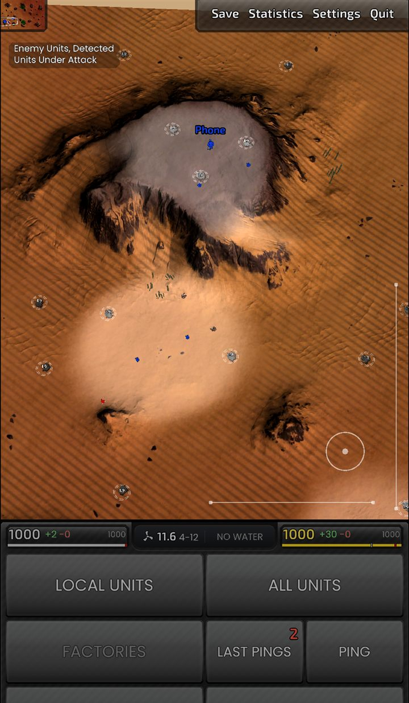

**PING** places your own ping:

- Tap PING, then tap the map: a ping there ("TAP THE MAP TO PING"; tap PING again to cancel).
- Hold PING and speak, then tap the map: a ping there with your words as its label.
- Tap PING twice: it turns to **CHAT**, speak to chat.

---

## Chat

### Speak to chat

You can send chat messages without typing. Tap the screen with three fingers (on the dock: tap PING twice).

1. "< SPEAK TO ALLIES >" shows in the channel's colour with a pulsing red dot.
2. Say your message. The phone's speech recognition listens.
3. What you said is sent as a chat message. If you said nothing, nothing is sent.

While it listens, a sideways swipe switches the channel between allies, everyone and spectators. The app keeps the channel for later messages and games, typed ones too.

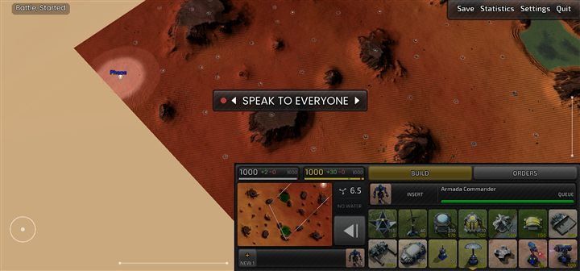

In a game, your words go to the game's chat only, not to the lobby. The first time, Android asks for the microphone. If you do not allow it, a note says "TO SPEAK, ALLOW THE MICROPHONE IN ANDROID'S SETTINGS". Allow it in Android's settings, Apps.

### Typing

- **Show the keyboard:** double tap with three fingers.
- **Open the typing box:** press Enter. The box opens at the top of the chat. Long messages wrap and get smaller, so the whole message stays in view.
- **Send:** Enter.
- **Switch channel:** Ctrl + Enter for everyone, Alt + Enter for allies, Shift + Enter for spectators.
- **Cancel:** Escape.
- **History:** Up and Down go through the messages you sent.
- **Paste:** Ctrl + V.
- **Commands:** start with "/". `/hud` opens the layout editor. `/padspeed` opens the gamepad's path speed tuner.

In the lobby, tap a chat's text box for the keyboard, or long-press it for speak to chat.

### The chat box

The app lays out BAR's chat for a phone: player names at the box's left edge, the message filling the rest. BAR's own messages ("Battle Started", a commander under attack, the tutorial's lines) show in the chat box for 15 seconds. When a game ends, the chat counts down the 12 seconds before BAR leaves it; a tap on the screen keeps it open longer.

> **Tip:** You can move the chat, size it and change its text size and padding in the layout editor.

---

## Spectating and replays

### Spectating by touch

When you watch a game or a replay with your fingers, the app gives you camera tools.

**Upright,** the dock has the spectator's tools as big buttons:

| Button | What it does |
|---|---|
| < PLAYER CAM > | Follow a player's camera; the arrows step through the players |
| TEAMS | Every team; tap one to watch it. CLOSE closes the list |
| LAST PINGS | The camera to the last pings |
| HIDE | Folds the dock to a SHOW button at the bottom; tap SHOW to bring it back |
| < FOLLOW UNIT > | Follow a unit; the arrows step through units by distance from the screen's middle |
| FREE CAM | Your own camera again |
| GROUP | Follow the unit's group instead of the unit alone |
| FULL VIEW | BAR's whole-map view, or the watched team's sight |

While you follow a unit, its camera views show: **1st person**, **Shoulder**, **Table**, **Close** and **Mid**, and **TUNE**.

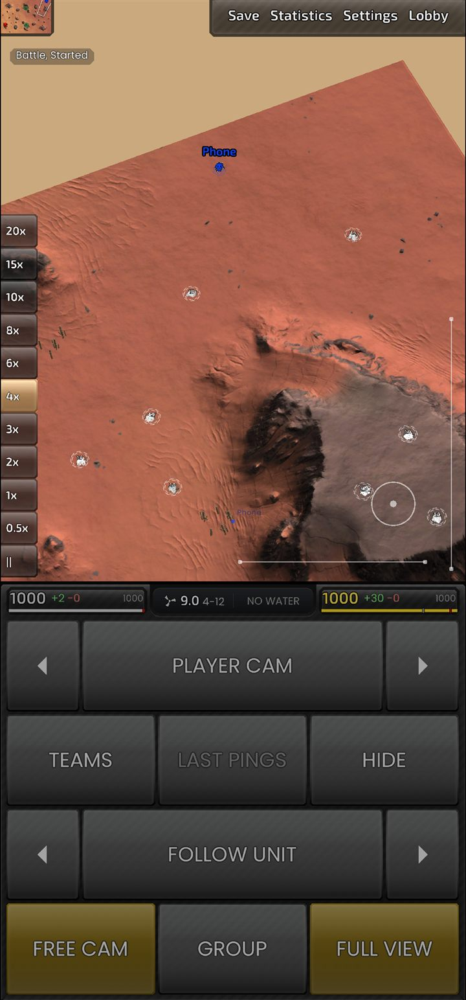

**Sideways,** BAR's player list stays small. Tap it to bring up the spectate bar for a few seconds. It has the players by name (switch whose camera you follow), the unit nearest the middle of the screen to follow, Group, and while following, the camera views.

**Everywhere:**

- Double tap a unit to follow it. Double tap the ground to stop.
- Following sticks: a pan moves the camera off the unit a little, and pinch, twist and tilt work as always. Only a pan that takes the unit far off the screen lets it go.
- In 1st person, drag to look around. The view turns back to the unit's by itself.
- **Tune** changes the view you are on, one setting at a time: 1st person and Shoulder for the unit type you follow, Table, Close and Mid for every unit. **Save** keeps it, and gives a unit type's views to the other factions' matching unit too.

### Replays

Open a replay from the lobby's **Replays**: tap **Start**. BAR's replay speed column shows on the left: 20x down to 0.5x, and a pause button. Tap a speed. A drag that starts on the column pans the map.

A replay, or any game with no other active player, pauses while the app is out of sight and goes on when you come back.

> **Tip:** Download replays from BAR's website, then use **Add** in Replays to copy them into the list.

---

## BAR's windows on a phone

BAR's top bar has buttons such as **Save**, **Statistics**, **Settings**, **Quit** and **Lobby**. Upright, the dock shows metal, energy, wind and tide, so BAR's own bars for them are hidden. The top bar's buttons still answer a tap where they lie over those hidden bars.

### Settings

With the phone engine, BAR's Settings window is laid out for the phone:

- Upright, it fills the screen under the top bar. BAR's tabs are a grid of buttons over the list, and the rows are larger.
- Sideways, it is as large as the screen allows.
- A red button closes it.
- Every setting works, also the ones that turn BAR's widgets on and off.

Tap the search field at the top to bring up the keyboard and type, for example "shadow": the list shows the matching settings. Android's Back first takes the keyboard down, then clears the search, then closes the window.

With BAR's official engine, BAR's own Settings window shows instead. Upright it is wider than the screen: open it sideways.

### Statistics

The top bar's **Statistics** (and the awards' **Show Graphs** at the end of a game) opens BAR's graphs. Upright, the window is the screen's width, between the top bar and the dock. Sideways it is as large as fits. A red button at its right end closes it. The camera knob and rails are off while it is open, so a drag on it does not move the camera.

### Mission Info

A scenario's briefing is no wider than the screen; upright it sits above the dock. A scenario starts paused with the Mission window open. Close it to start the game: tap the top bar's **Mission**, or tap the screen. The tap that closes it does not also click the map behind it.

### Save and load

The top bar's **Save** saves the game. The units you had picked stay picked, and the chat box says "Game saved: the lobby's Load Game opens it". Load it later from the lobby's **Load Game**.

### Quit

The top bar's **Quit** shows BAR's question: **Stay**, **Resign** or **Quit**. Android's Back with nothing left to put away shows BAR's lobby over the game in a game started from the lobby, else the same question.

---

## Gamepad

The app has full gamepad controls in every game: skirmish, online and spectating. They rebuild the layout of BAR Controller Support v0.8.5 from a mouse and keyboard. The pointer stays in the middle of the screen, as v0.8.5's reticle.

All of it works in online games, also where a host forbids widgets that give units orders: the pad goes the way BAR's own hotkeys and menus go. Only first person needs those widgets ("FIRST PERSON OFF IN THIS GAME").

### The pad in a game

| Pad | In the game |
|---|---|
| Left stick | Pan the map under the pointer (LT held: faster) |
| Right stick | Turn (left and right) and zoom (up and down; LT held: faster). With LB held: tilt |
| A | Select (twice: that type on screen); place a building |
| A held | Nothing picked: area select, a circle in the middle that selects your units as you pan (RT: added to the selection, buildings too; D-pad: bigger or smaller; B: undo; X held as well: the filter radial, where the left stick picks all mobile, combat, builders or air). Builders are never selected together with combat units. With an order picked, held for a quarter second: the left stick moves the pointer to draw an area or a row |
| X | The smart order there (BAR's right click: move, attack, repair, reclaim, guard). Held for a quarter second, the left stick draws a path |
| B | Cancel the order or building picked, else clear the selection |
| RT held / RB held | Queue (Shift) / put the order first in the queue (Space; for a factory's queue: Alt) |
| RB | The build menu: the pointer onto its first option. The D-pad steps, RB and LB page, A picks (factories: queue one, RT + A five), X takes one off (RT + X five), B lets go |
| Back + RB | The order menu, the same way. A gives the order |
| D-pad | Right or left: next or previous idle builder. Down: the commander. Up: a camera bookmark (LT + up stores it) |
| LB + D-pad | Right or left: next or previous idle unit (not builders). Down: all idle units of that type |
| RB + D-pad | Up tapped: the camera to the last ping from another player. Up held: a ping in the middle. Down: all your combat units. Right: your combat units on the screen |
| LB + A / X / Y / B | Fight (or attack the enemy there) / attack / patrol in the middle. B: stop (twice: repeat; held: wait; with factories: stop them and clear their queues). With builders, A repairs and X reclaims |
| LB + A held / LB + Y held | Draw a fight / patrol path with the left stick |
| Start or Back + D-pad | Control groups: up and down pick the group; left tapped selects it, left held assigns the selection's types; right tapped moves the camera to it, right held clears it |
| Back + Y | The path speed tuner (also `/padspeed` in the chat) |
| LB + L3 held | First person on the selected unit or sentry |
| L3 / R3 | Remove the next / the last queued order. Back + R3 + L3 held: self-destruct |
| LB + RB + R3, or Back + R3 | The D-gun mode: a red ring shows the range, the right stick aims, the left stick walks, RT fires, B leaves |
| LB held + RB twice | Speak to chat |
| LB held + RB three times | A ping in the middle, labelled with what you say ("SPEAK THE PING") |
| LB + D-pad up, tapped then held | The share list: units, metal or energy to a teammate |
| Back + Start | A free pointer on the left stick, for any of BAR's windows, and back |
| A building picked | A places it, X places it and keeps it, D-pad left and right turn it, up and down space a row, B puts it away. LB held: a grid ("GRID"): A starts it, the left stick draws it, A places it |

### The pad's panels

The pad's panels share the touch dock's look: its tiles, gold on what is picked, white words.

**The share list** (LB + D-pad up, tapped then held): your teammates, each name in capitals with the player's colour along its row's foot. LB and RB switch between UNITS, METAL and ENERGY. Each row shows how much of it the teammate holds. D-pad up and down picks the teammate, D-pad left and right how much to give (10 % to 100 %), never more than BAR lets them take. A sends (TRANSFER for units), B cancels. With units selected it opens on UNITS, else on the resource you used last.

### First person on the pad

Hold LB + L3 on a selected unit or sentry. The left stick walks it in any direction. The right stick looks anywhere. RT fires along your view. Back tunes the camera. B, or the same chord again, ends it.

A squad takes orders meanwhile (the unit you look at, else the units nearby): A follow me, X stop, Y fight, RB patrol to where you look. D-pad up adds units, down clears the squad. Riding the commander, RB fires the D-gun where you look.

### Pad and touch together

Once you use the pad, the build menu shows only when RB opens it, as in v0.8.5. Three taps on the screen within 6 seconds bring back the menus that open by themselves for fingers. While the pad is in use, the orders it has buttons for (Stop, Wait, Attack, Repeat, Move, Reclaim, Repair, Fight, Patrol) are hidden from the order menu, and the rest fill it with bigger buttons. They come back when the three taps hand the game back to your fingers, and at the next game's start.

### For pros: gamepad

- **Back + Y** sets how fast X, LB + A and LB + Y draw paths at each zoom.
- **LT + D-pad up** stores a camera bookmark; D-pad up brings back its place and zoom.
- **Start + D-pad left held** assigns the selection's types to a group, so new units of those types join it.
- **LB + B with factories selected** stops them and clears their whole queues.

---

## Mouse and keyboard

A Bluetooth or USB-C mouse and keyboard (or a USB-C dock) work as on a PC: with them the app plays like BAR on a PC.

- While BAR is in front, Android's, One UI's and DeX's own keyboard shortcuts go to the game instead: Alt+Tab, the Windows key, Ctrl+Space and the keyboard's language switch. The launcher setting "Keyboard shortcuts go to the game" (on by default) does this.
- Android keeps the Home, Recents, power, volume, brightness and media keys, and the swipe gestures (in the game they take a second swipe).
- Back first puts away what the touch dock has open. At the dock's home it brings up BAR's lobby over the game, or BAR's quit question in a game not started from the lobby. Without the dock (a gamepad or mouse sideways), and while BAR's quit question or the chat is open, Back is Escape.
- Sideways, a mouse brings back BAR's own screen layout. Touch the screen and the dock returns.

> **Note:** On Android 17, each Escape shows Android's notice "Long press Esc key to close this app". A short press is Escape for BAR, as on a PC. Holding Escape down (about 3 seconds) closes the game. Never hold Escape in a game you want to keep.

**Before Android 16.1,** Android takes its shortcuts before any app. The optional accessibility service sends them to the game:

1. Open Android's Settings, Accessibility, Installed apps.
2. Tap **Beyond All Reason keyboard shortcuts** and turn it on.
3. If Android says the setting is restricted: Settings, Apps, Beyond All Reason, the menu (three dots), Allow restricted settings. Then turn it on.

The service reads keys only while the game screen is in front. Home, Recents, power and volume keys stay Android's.

---

## The layout editor

The layout editor moves and sizes the interface's panels, in a running game, while you play or spectate. You see the real game behind it, so you can place each panel exactly where it suits your hands and your screen.

### What the editor changes

The editor can change four things on a panel. Which of them a panel allows depends on whose panel it is.

| Change | What it does | Range |
|---|---|---|
| Move | Drag the panel to another place on the screen | Within the screen |
| Size | Makes the whole panel bigger or smaller | 40 % to 250 %, about 8 % per tap |
| Text | Makes the panel's words bigger or smaller | 50 % to 200 %, about 8 % per tap |
| Padding | Makes the space inside the panel bigger or smaller | 0 % to 300 %, 25 points per tap |

- **The app's own panels** (the chat, the unit info panel, the spectate bar) take all four.
- **The build menu and the camera knob** can be moved and sized.
- **BAR's minimap and player list** can only be sized. BAR lets another widget change their size, and nothing else.
- **BAR's top bar, order menu and start countdown** cannot be moved or sized. BAR has no setting for it. Their size follows BAR's interface scale.

### Open and close the editor

**To open it:**

- Hold three fingers on the screen, or
- Type `/hud` in the chat and press Enter.

**To close it:**

- Tap **Done**, or
- Hold three fingers on the screen again, or
- Press Escape on a keyboard.

Your changes apply at once and the app keeps them for later games. There is no Save button.

> **Note:** The game does not pause while the editor is open. In a game of your own, tap PAUSE first if you need time.

While the editor is open, the whole screen belongs to it. A drag moves a panel instead of panning the map, and hotkeys do nothing.

### What you see

When the editor opens, the screen dims a little, and every panel it knows shows its outline:

- A **yellow** outline: you can change this panel.
- A **grey** outline: BAR fixes this panel. Its name says so, for example "Top bar (fixed by BAR)".
- A **thicker outline with a light fill**: the panel you picked.

Each outline has a name tab, usually on its top edge, outside the panel. If another panel is in the way, the tab goes on the bottom edge or in the top left corner.

A panel the touch dock covers whole has no outline: there is nothing of it to see or size.

### The control bar

The control bar is the row of dark buttons in the middle of the screen. With the dock across the bottom (upright, unfolded), it sits in the middle of the room above the dock. It keeps clear of the panels at the screen's edges, and moves above or below the panel you picked if it would cover it. If it does not fit in one row, it wraps onto more.

**With no panel picked,** the bar shows:

| Part | What it is |
|---|---|
| Tap a panel, drag to move, pinch to size | A hint |
| Reset all | Puts every panel back as it was, for this screen shape |
| Done | Closes the editor |

**With a panel picked,** the bar shows only what that panel allows:

| Part | What it does |
|---|---|
| The panel's name (lit) | Which panel is picked |
| - Size 100% + | Smaller, the size now, bigger |
| - Text 100% + | Smaller words, the text size now, bigger words |
| - Padding 100% + | Less space inside, the padding now, more space |
| Reset | Puts this panel back as it was, for this screen shape |
| Done | Closes the editor |

**With a fixed panel picked,** the bar shows its name, "BAR has no setting for it", and Done.

### Pick, move and size a panel

**Pick a panel:** tap inside its outline. Where panels overlap, a tap picks the one already picked if it is there, else the smallest one under your finger. Tap empty space to pick nothing.

**Move it:** put your finger on the panel and drag. The panel follows your finger. Panels that cannot move (the minimap, the player list) stay put.

**Size it:** pinch with two fingers to make the picked panel bigger or smaller, as you would zoom a photo. Or tap **-** and **+** beside "Size". Each tap changes the size by about 8 %. With a mouse, the wheel does the same.

**Text and padding:** tap **-** and **+** beside "Text" or "Padding". The number between them shows the value now.

### Reset, Reset all and Done

- **Reset** (with a panel picked) puts only that panel back to its place and sizes, for the screen shape you are in now.
- **Reset all** (with nothing picked) puts every panel back, for the screen shape you are in now. The other shapes keep their layouts.
- **Done** closes the editor. Your changes are already kept.

### Every panel and what it allows

| Panel (its name in the editor) | Whose | Move | Size | Text | Padding | When it shows in the editor |
|---|---|---|---|---|---|---|
| Chat | The app's | Yes | Yes | Yes | Yes | Always |
| Unit info | The app's | Yes | Yes | Yes | Yes | Only where the touch dock does not place it |
| Spectate bar | The app's | Yes | Yes | Yes | Yes | While you spectate by touch |
| Build menu | The app's copy of BAR's | Yes | Yes | No | No | Only while it shows, where the dock's grid is not in its place |
| Camera knob | The app's | Yes | Yes | No | No | While the knob is on (Settings, Control) |
| Minimap | BAR's | No | Yes | No | No | Always |
| Player list | BAR's | No | Yes | No | No | When the dock does not cover it |
| Top bar (fixed by BAR) | BAR's | No | No | No | No | Always |
| Order menu (fixed by BAR) | BAR's | No | No | No | No | While it shows |
| Build menu (fixed by BAR) | BAR's | No | No | No | No | Only where BAR's own build menu runs instead of the app's copy |

What each change means for each panel:

- **Chat.** Size changes how wide the chat box is and how many lines it shows: 8 lines at 100 %, at least 2. Text changes the size of the words. Padding changes the gaps. Move places the box; before the game starts it still keeps clear of BAR's start countdown.
- **Unit info.** Size changes the panel. Text sets the largest text size: the panel picks the largest size at which everything still fits, up to that. Padding changes the space inside. Made bigger, the panel stops at the order menu's left edge, so the order buttons stay free. The build menu keeps clear of it.
- **Spectate bar.** All four, for the bar of spectator buttons.
- **Build menu.** The app's copy of BAR's own Build menu: a 3 x 3 grid, 9 build options a page, the page arrows in a strip under them. On a wide, short screen (such as a folded Fold held sideways) it is up to 5 wide. Move and Size place and scale it.
- **Camera knob.** Move places the knob; Size makes the ring bigger or smaller. The rails are not in the editor.
- **Minimap.** Size scales BAR's minimap: it is your own BAR minimap size times this. Unfolded, where the minimap is small until tapped, the small one is half of that; upright the small one is as tall as BAR's top bar.
- **Player list.** Size scales BAR's player list, both the small list and the open one. Its outline takes in the rows BAR stacks on it (the music, unit totals, the clock), with its name tab above them.

### Layouts per screen shape

The editor keeps a separate layout for each of three screen shapes. When the phone turns or unfolds, the panels switch to that shape's layout.

| Shape | What it is | Example |
|---|---|---|
| Tall | The screen is at least 1.6 times as tall as it is wide | A phone held upright, a folded Fold held upright |
| Wide | The screen is at least 1.6 times as wide as it is tall | A phone held sideways, a folded Fold held sideways |
| Near-square | Anything in between | An unfolded Fold, held either way up |

So you can make the chat small upright, where the screen is narrow, and larger unfolded, where there is room. Reset and Reset all work only on the shape you are in.

BAR's own interface scale also follows the shape: 2.0 on a folded phone held sideways, 1.0 on a folded phone held upright and on an unfolded screen. The fixed panels' sizes come from that scale.

### The editor and the touch dock

The touch dock changes what the editor shows:

- With the dock up, the dock places the unit info panel and holds the build grid. The editor then does not outline the unit info panel or the build menu, because the dock decides where they go. To size them in the editor, use BAR's own layout: sideways with "Touch dock sideways" off.
- Panels under the dock (often the player list upright) have no outline.
- With the dock across the bottom, the control bar sits in the room above it, clear of the wind and tide pill.
- Beside the sideways dock, the control bar stays in the middle of the screen.

### Editor recipes

**Make the chat smaller upright:**

1. Hold the phone upright. In a game, hold three fingers on the screen.
2. Tap inside the Chat outline.
3. Tap **-** beside Text two or three times. Tap **-** beside Size to show fewer lines.
4. Drag the chat where you want it.
5. Tap **Done**.

**Move the camera knob out of the way:**

1. Open the editor.
2. Tap the Camera knob's outline.
3. Drag it to where your thumb rests, away from where you place buildings.
4. Pinch to make it bigger if you miss it often.
5. Tap **Done**.

**Make the minimap bigger unfolded:**

1. Unfold the phone. In a game, open the editor.
2. Tap the Minimap outline.
3. Pinch outwards, or tap **+** beside Size.
4. Tap **Done**. The small minimap (until tapped) is half of the new size.

**Start over:**

1. Open the editor.
2. Tap empty space so nothing is picked.
3. Tap **Reset all**. Only the screen shape you are in is reset.

### For pros: the editor

- Set up each screen shape on its own. Turn or unfold the phone, open the editor, and arrange that shape.
- The size, text and padding steps are about 8 % for Size and Text. Five taps of + is about 1.5 times.
- The Text setting of the unit info panel is a ceiling, not a fixed size: the panel still shrinks its text to fit. Raise Size together with Text for bigger words.
- With a mouse and keyboard, `/hud` opens the editor, the mouse wheel sizes the picked panel, and Escape closes it.
- A movable top bar, order menu and start countdown would need a setting in BAR itself. The editor shows the top bar and the order menu in grey so you know they are fixed.

---

## Every launcher setting explained

Each setting shows its name and what it does on the launcher screen. The start buttons use what the screen shows. **Save settings** keeps them without starting anything.

### Game

| Setting | Default | What it does |
|---|---|---|
| Map for Play vs AI | Supreme Isthmus v2.1 (Starwatcher 1.0 on 8 GB phones, until you pick one) | The map Play vs AI starts on. Tap for the maps installed, or type any map's name and version as BAR lists it: a map not on the phone is downloaded |
| Sound | On | The game's sound |
| Open the lobby when the app starts | On | The app icon opens the lobby straight away. Long-press the app icon, then Launcher, for this screen |
| Update BAR at every start | On | Like BAR's PC launcher: engine, game and lobby update at every start, and go back to the last working version if an update fails to start. Off: only Install / Update updates BAR |
| Phone engine | On | BAR's engine built for phones: the touch and pad controls in every game, the phone Settings, faster skirmishes and replays. Off: BAR's official engine |
| BAR touch controls | On | The app's touch gestures: drag pans, pinch zooms, twist turns, two fingers up or down tilt, tap then drag selects, long press gives orders. Off: the touch modes under Display |
| Turn with the phone | On | With the phone's auto-rotate on, the lobby and the game turn upright or sideways as you hold the phone, at any time. With auto-rotate off, Play upright decides |
| Play upright (portrait) | Off | The lobby and the game upright while they do not turn with the phone: the game on top, the touch dock below |
| Touch dock sideways | On | Held sideways, the touch dock at one side of the bottom, for one thumb. A gamepad or mouse brings back BAR's own screen |
| Keyboard shortcuts go to the game | On | Alt+Tab, the Windows key, Ctrl+Space and the soft keyboard's language switch reach BAR while it is in front. Off: Android's own |
| Map storage | 3 GB | 3 GB, 5 GB or No limit. Downloaded maps are kept under this. Before a game starts, the maps played longest ago are deleted; they download again when a game needs them. The line shows how much is used now and in how many maps |

### Graphics

| Setting | Default | What it does |
|---|---|---|
| Frame cap | 30 fps | The most frames drawn a second: 30 fps, 60 fps or No cap. 30 keeps the phone cooler and the picture steady; no cap runs it hot |
| Game resolution | 100% | 100%, 85%, 70% or Native. The game's picture is up to 2100 x 900 pixels (900 lines folded sideways, 1080 unfolded), enlarged to the screen. Lower runs cooler. Native is the screen's own resolution, the heaviest |
| Sharper upscaling (Qualcomm SGSR) | On | The game is drawn smaller than the screen and enlarged. SGSR keeps edges sharp where plain enlarging blurs them |
| Compare upscaling (diagnostic) | Off | SGSR on and off every 3 seconds, with a label, to see the difference |
| Lower the resolution when fps drops | Off | From the third game minute, under 27 fps the game is drawn smaller a step at a time (85 %, then 70 %), never under 70 % of the full picture, kept only while each step helps. Nothing changes at Native or 70 % |

### Advanced

These are for testing and comparison. Most players never change them.

| Setting | Default | What it does |
|---|---|---|
| Worker threads | 4 | The engine's helper threads for the simulation and drawing (BAR's WorkerThreadCount) |
| GPU driver download (Mesa for Android) | The app's own address | The address of the graphics driver build the app's Linux environment installs |
| Use Turnip + Zink instead of Freedreno (kgsl) | Off | OpenGL through Mesa's Vulkan driver instead of its own OpenGL one; for comparison |
| Force OpenGL 4.5 compatibility profile | Off | The driver reports OpenGL 4.5 whatever it offers; only to test a driver that reports less |
| Lobby bridge | On | The app stands in for BAR's PC launcher: the Replays tab, web links, skill ratings and the lobby's downloads. Off: the Replays tab cannot list replays |
| Proot without seccomp acceleration | Off | Every system call of the game stops in the Linux environment: much slower; only to test |
| Verbose X server logging | Off | The display server's debug output in the log |

> **Tip:** Leave the Advanced settings alone unless a bug report asks you to change one. "Lobby bridge" off breaks the Replays tab.

---

## Performance and heat

### What to expect

- About 30 fps on a Snapdragon 8 Elite phone, with the frame cap at 30 (the default). The app keeps every picture on screen for the same time, so 30 fps looks steady.
- Big late-game battles with thousands of units run slower. The phone runs the whole game simulation, as a PC does. The game still keeps pace with real time: a spectated 8v8 with about 3,600 units ran at 0.97 to 1.02 times real time.
- Late in big games, the phone's CPU is the limit, not the drawing. A lower game resolution mostly keeps the phone cooler rather than raising the frame rate.
- Heat sets the speed. In tests on a Samsung phone, the CPU clocks dropped within about 20 seconds of a battle, and lower still after an hour of play.

### Settings that help

| Goal | Do this |
|---|---|
| A cooler phone | Keep Frame cap at 30. Lower Game resolution to 85 % or 70 % |
| Fewer drops in big fights | Turn on "Lower the resolution when fps drops". It steps down to 85 %, then 70 %, only while each step helps (at a Game resolution of 100 % or 85 %) |
| A sharp picture at a lower resolution | Keep "Sharper upscaling (Qualcomm SGSR)" on |
| Enough memory | Close other apps before a game. On Galaxy phones, use Free memory while BAR loads |
| Room on the phone | Set Map storage to 3 GB |

In big games (10 teams or more) the app turns off BAR's sonar, radar and line-of-sight circles and its always-shown jammer coverage. Your own settings come back in the next smaller game.

The app is a game for Android and One UI: Game Booster and Gaming Hub see it. In one test, Android's performance game mode gave 1-2 fps more in a late 8v8.

### Battery and charging

A game draws more power than a computer's USB port gives. Over hours of play the battery runs down even while plugged into a computer. Use a wall charger for long sessions.

> **Tip:** A game you leave keeps its connection, so an online match survives a quick look at another app. A game of your own (or a replay) pauses while the app is out of sight.

---

## Troubleshooting and logs

### Share logs

If something goes wrong:

1. Open the launcher (long-press the app icon, then Launcher).
2. Tap **Share logs**. The app makes a zip of the app's and the game's logs and settings.
3. Attach the zip to an issue on the project's GitHub page, with your phone model and what happened.

An online game's join password, which the game writes into its log, is taken out of the zip first.

The launcher's log also says how the last run ended (a crash, low memory, a force stop) and what the app was doing then.

### Common problems

| Problem | What to do |
|---|---|
| The picture freezes early in a game | The phone's GPU driver hit its rare fault (on one test phone, about 1 start in 10 to 25). The app closes the frozen game and says why. Start it again |
| The game closed in a big online game | Android closed it for lack of memory. The launcher says so at its next start. Close other apps before a big game |
| BAR stopped with an error | The launcher shows BAR's message |
| A start hangs for up to 45 seconds | A weak connection: BAR's update check waits. Turn off "Update BAR at every start" |
| A map will not start offline | Offline, only maps already on the phone work. Pick one in the lobby's map list |
| No touch or pad controls in an online game | The host turned off custom widgets. The lobby warns in red when you join. With the phone engine on, this no longer stops the controls |
| Auto retreat or full-auto D-gun is off | You run BAR's official engine and the host turned off unit control widgets ("OFF IN THIS GAME"). With the Phone engine on, they work |
| Turning the phone freezes the game for a moment | BAR's panels take the new size: about a second with the phone engine, 5 to 10 seconds with the official engine |
| BAR's Settings is wider than the screen upright | You run BAR's official engine. Open Settings sideways, or turn the Phone engine back on |
| The game closed when you held Escape | Android 17 closes an app when Escape is held. Use short presses |
| Speak to chat does nothing | Allow the microphone for Beyond All Reason in Android's settings, Apps |
| Converters make no metal | Your energy is under the conversion mark. Open the energy bar and move the pale knob |

> **Note:** If BAR's servers move to an engine version the app has no phone build of, every game runs BAR's official engine until a new app version. Some phone fixes are then missing, such as the sea version of a building picked only where your finger taps water.

---

## FAQ

**Is BAR Droid made by the Beyond All Reason team?**
No. It is a fan project. BAR's game content downloads from BAR's own servers.

**Can I play online with PC players?**
Yes. The app runs BAR's engine at the version BAR's servers run. Online, the engine keeps BAR's own simulation code, so games stay in step with everyone.

**Do I need a BAR account?**
Only for online play. Skirmishes against the AI, scenarios and replays work without one.

**Does it work offline?**
Yes, once BAR is installed. Play vs AI and the lobby's Skirmish work offline on maps already on the phone.

**Which phones work, and how much space does it need?**
Snapdragon 8 Gen 2, 8 Gen 3, 8s Gen 3 and 8 Elite phones, 12 GB of RAM (8 GB in a low-memory mode), about 6 GB free. See [What phone you need](#what-phone-you-need).

**What is the phone engine, and is it safe online?**
It is BAR's engine built for phones from the same source, with the app's controls, phone layouts and memory settings. Its faster simulation runs only in skirmishes and replays. Online it keeps BAR's own simulation code. You can turn it off with the launcher's "Phone engine".

**Can I use a controller, or a mouse and keyboard?**
Yes to both, in every game. See [Gamepad](#gamepad) and [Mouse and keyboard](#mouse-and-keyboard).

**Why does the app ask for the microphone?**
For speak to chat and spoken ping labels. Nothing is sent if you say nothing. You can refuse it; everything else works.

**Can I turn the phone mid-game?**
Yes, with "Turn with the phone" on and the phone's auto-rotate on. The game redraws its interface in about a second with the phone engine.

**How do I watch replays from BAR's website?**
Download them, then use **Add** in the lobby's Replays. Android's file picker opens in Downloads.

**Why does my battery drain while plugged into my computer?**
A game draws more power than a computer's USB port gives. Use a wall charger.

**Will the app keep being updated?**
Its author does not plan to keep developing it. It updates BAR itself at every start, and runs BAR's official engine when BAR moves to an engine version the app has no phone build of.

---

## Glossary

| Word | Meaning |
|---|---|
| AI | A computer player. BAR's AI is called BARb |
| Area order | An order drawn as a circle on the map, such as Area Mex, Reclaim or Repair |
| Armada, Cortex, Legion | BAR's factions |
| Auto mex | The app's helper: commander picked and a Metal Extractor chosen, the free spots in range are queued |
| Build power (buildpower) | How fast a builder builds |
| Builder, constructor | A unit that builds: the commander, Construction Bots, Construction Vehicles and others |
| Commander | Your starting unit. It builds, fights and has the D-gun. Losing it can lose the game |
| Converter | Energy Converter: turns spare energy into metal |
| D-gun | The commander's special weapon: a very strong shot that uses a lot of energy. Enemy commanders are immune to it |
| DPS | Damage per second |
| Dock | The touch dock: the app's panel of large buttons for touch play |
| Edge rails | The two thin lines in an L at the map's bottom corner: zoom and turn with one finger |
| Energy | One of BAR's two resources, from wind, solar, tidal and other generators |
| Factory | A building that makes units, such as a Bot Lab |
| Fight | Attack-move: move and attack what is on the way |
| Home buttons | The dock's buttons with nothing picked |
| INSERT | The dock's switch that puts the next order at the front of the queue (BAR's Space key) |
| Interface scale | BAR's size for its interface; the app sets it per screen shape |
| Knob | The camera knob: a ring over the map that zooms and turns with one finger |
| Layout editor | The app's tool to move and size panels (three fingers held) |
| Lobby | BAR's menu screens: login, servers, skirmish, replays |
| Metal | One of BAR's two resources, from metal extractors and reclaiming |
| Mex | Metal Extractor: a building on a metal spot |
| Phone engine | The app's build of BAR's engine for phones |
| Ping | A marker on the map that your allies see |
| Preset | The app's formations and strafing orders |
| QUEUE | The dock's switch that adds the next order to the end of the queue (BAR's Shift) |
| Reclaim | Taking metal or energy back from wrecks, rocks, trees or your own buildings |
| Replay | A recording of a game (`.sdfz` file) |
| Sentry | A defence tower |
| Skirmish | A game against AI players |
| Spectate | Watch a game without playing |
| T1, T2 | Tech levels: basic and advanced units and buildings |
| Tide | The tidal energy of a map with water |
| Wind | The wind speed, which sets what Wind Turbines make |

---

## Credits

- **Beyond All Reason** and its game content are by the Beyond All Reason team: [beyondallreason.info](https://www.beyondallreason.info/). BAR's game, maps and engine are not bundled with the app; they download from BAR's own servers. The app ships upright copies of BAR's load screen and lobby pictures, with BAR's developers' clearance.
- **The Recoil engine** by the Spring and Recoil developers.
- **Termux:X11** (the display server), **PRoot** and other parts from the Termux project.
- **Mesa for Android containers** (the graphics driver).
- **Qualcomm Snapdragon Game Super Resolution** (SGSR) for the sharper upscaling.
- **BAR Controller Support v0.8.5**, whose layout the gamepad controls rebuild.
- The full list of third-party parts and their licences is in NOTICE.md.

BAR Droid's own code is GPL-3.0-or-later. Its code was written with an AI assistant (Claude Code) at its author's direction. Project: UnderarmCape on GitHub.

BAR Droid is a fan project, not made by the Beyond All Reason team.
